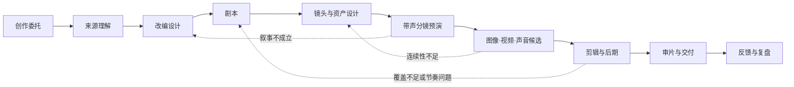

# VSC · Video Short Create

VSC 是一个独立的短剧／短视频创作工作流。它把小说、原创故事、品牌资料或外部交接包，组织为可追溯的：**改编 → 剧本 → 镜头与资产 → 带声预演 → 图像／视频／声音候选 → 获选素材 → 剪辑、混音 → 审片与交付**。

<!-- vsc:view version -->
当前版本：**v0.22.1**，各版本变化见 [版本记录](docs/releases/)。
<!-- /vsc:view -->

VSC 不嵌入、不调用其他插件。任何外部系统都只能作为文件来源，或提供标准 `creative-handoff/v1` 交接包；VSC 对导入后的创作与制作负责。

你可以在支持的 AI 客户端中用自然语言启动创作，也可以用本地 CLI 管理版本、质量门和制作任务。创作选择由真实负责人批准；生成成功的媒体先作为候选保存。

## 为什么存在

短剧制作不应等同于“输入小说，连续调用几个生成模型”。真正需要被管理的是：

- 创作意图：为谁做、让观众看到什么、什么绝不能改；
- 来源依据：原文事实、人物说法、解释、改编、新增与待定不能混为一谈；
- 创作选择：剧本、表演、运镜、转场、音乐和最终 take 由明确责任人选择；
- 生产连续性：人物、场景、动作、声音和镜头参考必须跨镜、跨集可复用；
- 版本与返工：每份产物要有来源、依赖、批准状态与新鲜度；问题要退回最早的责任环节；
- 团队差异：不同工作室应能替换 Profile、角色、质量门和生成适配器，而不改写核心语义。
- 可持续复用：经过权属核验、试用和评测的创作方法应成为团队能力；来源素材、临时对话和未经验证的模型输出不能越过这个边界。

VSC 的基本立场是：**意图先于生成，产物先于任务，人对创作选择负责。**

## 两种入口

### 新手：只说需求

```text
/vsc 把一部都市悬疑小说改成 20 集竖屏短剧
/vsc 我只有“雨夜收到假信”的想法，想做一条 60 秒剧情短片
```

`/vsc` 会识别已有来源、受众、时长/画幅、目标、约束和责任人；信息不足时给出一项推荐和少量备选，每轮只收敛一个会影响后续工作的决定。它再选择 Profile，安排专业角色，并把产物与决定记录进项目状态。

### 熟手：直接打磨一个环节

各环节的命令、route 与角色见 [AGENTS.md 的路由表](AGENTS.md)（由 `workflow/kernel.json` 生成）。

熟手不会被迫重走访谈；VSC 只读取当前环节所需的已批准产物，并补足受影响的依赖。

## 生产主线



在 S6 中，图片、视频、声音都是候选 take，不会因为“生成成功”自动进入成片。带临时对白、音效和音乐节拍的 S5 预演，是在扩大生成成本前检验叙事、时长和镜头关系的关键点。

新作品使用 `production-v2` 制作规则：逐场核对剧本覆盖，固定获选素材与时间线的版本，再核对混音、真实媒体 QA 和完整范围的人工审片。详见 [制作交接与正式运行规则](workflow/production-v2.md)。

## 快速开始

在 Codex、Claude Code、Grok Build、Kimi Code 或 ZCode 中打开仓库根目录，开始新会话后直接说“用 VSC……”。快捷入口包括 Codex 的 `$vsc`、Claude Code／Grok Build 的 `/vsc`、Kimi Code 的 `/skill:vsc`；ZCode 的插件面板安装步骤见 [AI 客户端接入](docs/guide/workspace-setup.md)。

也可以直接使用命令行。项目状态机只依赖 Python 标准库；以下命令从仓库根目录执行，先把作品名、标题和负责人换成实际值：

```bash
python3 -B scripts/vsc_kernel.py doctor        # 核对内核、入口与各客户端配置
python3 -B scripts/vsc_state.py profile list   # 查看可选业务 Profile
python3 -B scripts/vsc_state.py init ./projects/作品名 --title "作品标题" --profile vsc.light-short --owner "实际负责人"
python3 -B scripts/vsc_state.py status ./projects/作品名
python3 -B scripts/vsc_state.py next ./projects/作品名
```

### 选择 Profile

| 制作需求 | Profile |
|---|---|
| 单条原创或资料改编短视频，采用精简交付与固定版本包审阅 | `vsc.light-short` |
| 原创剧情短片、一般叙事短视频 | `vsc.narrative-base` |
| 小说改编连续短剧 | `vsc.novel-serial` |
| 品牌叙事短视频 | `vsc.brand-story` |
| 需要固定资产、状态时间线和场次衔接的短视频 | `vsc.engineered-short` |
| 按集管理人物、状态、声音与章节承接的连续短剧 | `vsc.engineered-serial` |

Profile 固定阶段顺序、必需产物与质量门。轻量单条减少重复交付，仍保留预演、获选素材、时间线、混音与审片链；工程化 Profile 的制作方法见 [工程化制作](docs/design/engineering-production.md)。

### 接续已有作品

在任一支持的客户端中说“用 VSC 继续 projects/作品名，先读取进度”，或运行：

```bash
python3 -B scripts/vsc_state.py status ./projects/作品名
python3 -B scripts/vsc_state.py next ./projects/作品名
# 连续剧可按实际分集 ID 查看进度与质量门
python3 -B scripts/vsc_state.py status ./projects/作品名 --scope EP-ID
python3 -B scripts/vsc_state.py next ./projects/作品名 --scope EP-ID
python3 -B scripts/vsc_state.py gate check ./projects/作品名 design --scope EP-ID
```

各客户端共用作品的 `vsc.json`、产物快照与台账；状态写入走 CLI。`projects/`、本机素材库和第三方源码不随 Git 提交，需要自行保存。旧作品保留原固定 Profile，采用 v2 规则前先查看 `profile migrate` 的差异与影响，再显式应用；操作见 [制作交接 v2 指南](docs/guide/production-v2.md)。

来源登记、产物版本、批准、契约校验、记忆与学习及外部交接的完整用法，见 [命令行使用](docs/guide/cli.md)。

## 从批准输入到正式交付

v0.12.0 将制作过程中的版本交接落实为可检查的契约：

1. **固定故事与设计依据**：来源保存快照与 SHA；剧本、镜头和声音按创作对象登记，覆盖计划逐场核对。新增剧情和有意省略需记录真实人工决定。
2. **审阅正式运行计划**：`production-run` 固定输入、请求参数、预算和人审暂停点。资产准备在剧本质量门通过后进行，镜头候选制作在预演质量门通过后进行；执行前核对批准版本。
3. **共享项目预算并安全续接**：图像、视频、语音、音乐和视觉检查共用原生单位额度；已有任务优先恢复，提交结果不明时停止重提。额度与平台实际金额分别记录，未知费用保持未知。
4. **选择素材后进入后期**：生成结果先导入为草稿，获选清单绑定具体输出、文件 SHA、用途、权属和选择人。时间线回指获选媒体，混音核对声音 Cue、实测时长与声音桥。
5. **复检并打包交付**：完整解码、音轨覆盖与响度检查绑定实际成片版本；人工审片绑定帧范围和交付 ID。可迁移包使用相对路径与 SHA 清单，移动后重新检查媒体与技术 QA。

正式运行、共享预算、包审阅、迁移与交付命令见 [v2 指南](docs/guide/production-v2.md)。低层生成队列由正式运行入口调用；新作品的付费执行从已批准的运行计划开始。交付包只复制清单中明确许可的材料，私有来源默认保留版本引用。

## 本机工具与素材复用

核心状态管理与云端适配器使用 Python 标准库。真实媒体探测、解码与响度检查需要 FFmpeg／ffprobe；Remotion 项目另需 Node/npm 依赖。工具存在、凭证配置、线上调用成功和人工验收分别报告。

```bash
# 只读诊断本机工具、默认凭证变量与作品候选，不探测云端权限
python3 -B scripts/vsc_toolchain.py --project ./projects/作品名 --json
```

本工作区的凭证集中在 `~/.zshenv`。若进程未加载变量，在启动工具的 zsh 中执行 `source ~/.zshenv` 后重新启动工具；其他启动方式需显式传入环境变量。具体变量及配置方式见 [客户端与本机配置](docs/guide/workspace-setup.md)。

- **图像与视频**：豆包适配器支持资产图、关键帧、图生视频、任务恢复和辅助视觉检查，保留实际输入、用量与输出记录，见 [生成适配器](docs/architecture/generation-adapters.md)。
- **声音与字幕**：支持预演临时配音、字幕烧录、本地原创环境声／拟音／简约配乐；固定音色语音与 Seed-Audio 适配器的验证状态见下表。
- **后期工程**：支持剪映草稿导出与 Remotion Composition 脚手架；v2 时间线将获选素材引用与原有帧级渲染计划绑定。Remotion 的源裁切、手柄、分数帧率和音量包络见 [Remotion 指南](docs/design/remotion.md)。
- **跨作品复用**：提供素材库、34 条公开创作方法、[20 类制作规格](docs/guide/asset-recipes.md)和[统一检索](docs/guide/reuse-and-search.md)。方法试用、评测与跨项目导出绑定版本和权属。

## 当前边界与路线

| 能力 | 已有证据 | 仍需验证 |
|---|---|---|
| 制作交接、正式运行与共享预算 | 离线回归覆盖完整 CLI 链、关键帧暂停／续跑及三集独立进度 | 真实项目中的创作、表演与制作效果 |
| 豆包图像／视频／辅助视觉检查 | 已有线上候选记录，验证日期与范围见 [适配器文档](docs/architecture/generation-adapters.md) | 每次使用的账号权限、素材适用性及完整人工审片 |
| [固定音色语音](docs/architecture/doubao-speech.md)与 [Seed-Audio](docs/architecture/doubao-audio.md) | 已实现适配器、离线协议与本地媒体验证 | 有效服务凭证下的真实云端合成、音色稳定和审听 |
| 剪映与 Remotion | 草稿／脚手架导出及字幕、字体、计划版本检查 | 新导出在剪映 UI 的保真回看；Remotion 依赖安装、类型检查、浏览器渲染与回看 |
| 可迁移交付包 | 已用真实合成媒体完成移动后的复检回归 | 实际作品的授权归档、跨环境工程复现与交付验收 |

`doctor`、契约校验和测试通过提供结构与行为证据。叙事理解、表演、情绪、口型、声音及审美仍须具名负责人观看／审听；具体回归与验收边界见 [v0.12.0 实施记录](docs/plans/2026-10-12-vsc-workflow-implementation.md)。

尚未验证的方向包括 3D、向量检索、真实 S3/MinIO 部署、完整货币费用账本、逐帧人脸／服装／道具／声纹比对、可视化时间线、真实观众实验与发布集成、模型训练／微调，以及从全部台账自动生成时间线的编译器。

下一步优先用一条 60 秒原创短片或一集小说短剧，验证来源、带声预演、正式运行、获选镜头、混音与完整人工审片的真实制作链。

## 文档地图

| 要做什么 | 从这里开始 |
|---|---|
| 连接 AI 客户端、配置本机环境 | [客户端接入](docs/guide/workspace-setup.md) |
| 新建项目、登记来源与产物、批准版本 | [CLI 指南](docs/guide/cli.md) |
| 执行制作、共享预算、迁移或交付 | [制作交接 v2](docs/guide/production-v2.md) |
| 组织图像／视频依赖批次 | [批量生产](docs/guide/production-batch.md) |
| 理解阶段、角色、契约及扩展点 | [工作流内核](workflow/README.md)、[术语表](GLOSSARY.md) |
| 安装或审核本地第三方 Skill／工具 | [Vendor 说明](vendor/README.md) |
| 修改工作流与运行本地验证 | [维护指南](docs/guide/maintenance.md) |

全部文档按读者分组列在 [docs/README.md](docs/README.md)。工作流规范以 `workflow/` 为准，技能正文在 `skills/`，宿主发现入口按声明生成。

## 维护

工作流改动直接提交并推送到 `main`。修改期间只跑受影响的测试；全部修改完成后，在最终推送阶段运行一次全量检查。启用仓库钩子时由 pre-push 执行；未启用时手动运行以下命令。作品、素材库、vendor 源码和本机配置保持在本机。

```bash
python3 -B scripts/vsc_local_ci.py
```

本地 CI 覆盖内核、全部测试、Vendor 路由、已有作品可读性、素材与方法库、Git 跟踪范围和文档链接。钩子启用、入口同步与维护规则见 [维护与本地验证](docs/guide/maintenance.md)。

## 许可证

VSC 自身代码和文档采用 [MIT License](LICENSE)。第三方来源的许可证与使用须知见 [第三方声明](vendor/THIRD_PARTY.md)，原则见 [Vendor 治理](docs/governance/vendor-governance.md)。

## 内建资源面板（v0.21.0）

通过 `uv sync --locked --all-extras` 安装，运行 `.venv/bin/vsc-panel` 浏览本机项目文案、素材与关系。PostgreSQL 新项目可管理用途候选、人工审查、正式选择、来源和生成输入，旧项目默认只读、不自动迁移。见 [资源面板指南](docs/guide/resource-panel.md)、[工程目录](docs/guide/code-structure.md)及 [v0.21.0](docs/releases/v0.21.0.md)。
