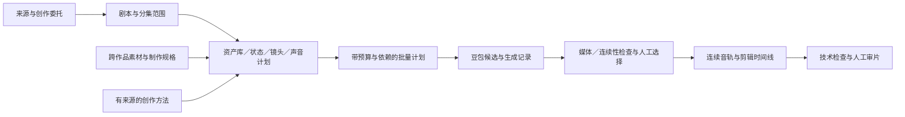

# 工程化短剧与短视频制作

本页把委托、素材复用、镜头制作、章节衔接和后期接成一条可执行路径。工作流仍由 `workflow/`、项目固定 Profile 和 `vsc.json` 管理；队列、素材库和供应商都不拥有批准权。

## 从正确的项目结构开始

新建叙事短视频可选 `vsc.engineered-short`，小说改编连续短剧可选 `vsc.engineered-serial`。两者沿用原有阶段与版本管理，并在视听设计 Gate 要求声音计划、场景状态时间线和集／场衔接。已有作品固定的 Profile 不会被自动迁移。普通 Profile 继续可用；现有作品继续按其固定规则执行，不能编辑快照来强行套用新 Profile。

```bash
python3 -B scripts/vsc_state.py profile show vsc.engineered-short
python3 -B scripts/vsc_state.py init projects/作品名 --title '作品名' --profile vsc.engineered-short --owner '实际负责人'
python3 -B scripts/vsc_toolchain.py --project projects/作品名 --json
python3 -B scripts/vsc_state.py next projects/作品名
```

连续剧用 episode → scene → shot 创作对象树标识分集范围，登记资产、剧本、状态和镜头时保留依赖版本。来源事实、角色外观、场景状态、音色、声音提示、具体生成参数各自只在负责它的文件维护；任务之间引用 ID、路径与 SHA，不靠复制聊天记忆。



## 复用优先于生成

先查 [素材库和方法库](../guide/reuse-and-search.md)。[制作规格包](../guide/asset-recipes.md)提供全部 20 类的起点，含固定与可变条件、制作步骤、验收和输出；动作／打斗带起止状态与安全节拍，声音带循环、对白避让和授权要求。规格是待应用的文本，不是已经生成的媒体或已选择音色。

```bash
python3 -B scripts/vsc_recipes.py install --all
python3 -B scripts/vsc_search.py '递物' --in recipes
python3 -B scripts/vsc_search.py '眼神 心理' --in craft
python3 -B scripts/vsc_library.py search '雨' --kind ambience
```

人物、场景、动物和道具保留规范图，服装、姿态、灯光、损坏等作为变体或状态。声音以 provider、模型资源和 speaker ID 固定绑定；相同 ID 提供可复现的参数依据，听感一致仍需审听。库中权利仅覆盖规格文字时，不继承为字体、音乐或人物素材的商用许可。

公开方法覆盖运镜、构图、视觉、对白、眼神、动作、心理语境、声音与剪辑。表情需结合情境解释，不能用外貌推断真实人格或把微表情当测谎；应用建议与来源概念分别标明，全部保留可打开的原始来源。

## 豆包链与有界执行

图像／视频／视觉复核使用 [方舟适配器](../architecture/generation-adapters.md)。固定音色对白使用 [豆包语音接口](../architecture/doubao-speech.md)，环境声／音效／音乐的可选生成接口见 [Seed-Audio](../architecture/doubao-audio.md)。服务开通与凭证权限分别核实；环境变量存在不能当作平台授权成功。

[批量生产](../guide/production-batch.md)先完整预检所有本地输入、媒体类别、输出目录、锚点、依赖和规模预算。计划 hash 绑定具体请求；显式执行后按依赖串行生产，失败停止，下次续接原任务。实际尾帧才能成为下镜输入。网络提交结果未知时保留凭证并停止，不能删记录重跑来掩盖可能的重复计费。

正式语音模型与 Seed-Audio 的云端权限未就绪时，仍可用 `procedural_audio.py` 生成原创本地环境底、拟音及简约配乐用于审听。它没有外部采样、不调用云模型，不冒充豆包音频结果。示例：

```bash
python3 -B scripts/procedural_audio.py --project projects/作品名 --name wind-01 --preset wind --duration 32
python3 -B scripts/procedural_audio.py --project projects/作品名 --name music-01 --preset music_pad --duration 32
```

预设为 `wind/rain/cloth/footsteps/ceramic/bell/music_pad`。生成记录有输入、seed、时长、峰值参数、SHA 和未选择状态；支持幂等复用，修改参数必须换名称。配乐与环境底按场景跨镜铺设；循环建议交叠处理，实际听觉接点、响度和对白避让由后期完成。

## 章节接续与交付

同场镜头从同一状态时间线推导出入点；跨场／跨集用 `vsc.sequence-links/v1` 绑定状态版本和边界镜头。carry 写尾部留下的行动或信息，receive 写后续如何承接；换场、时间省略或角色状态变化需给理由。声音桥对应同一声音提示表和时间线，不能每个短片段都重启音乐。

只检查 JSON 非空不能证明故事有效；依赖或锚点变化也不能沿用旧批准。项目负责人选择候选后再进入时间线，并完成技术 QA 与具名审片。批队列不会自动将成功生成视为通过 Gate。

`vsc_toolchain.py` 只读汇总实现、配置存在性、本项目可核验的候选记录、视觉报告及媒体／规格库存；它不会联网、不写项目状态，所有候选的人审状态仍为 pending。最终以项目 Gate、有效批准、实际审听和审片为准。
