# PostgreSQL 资源表字典

由 `scripts/project/schema.py describe` 生成；表定义与迁移是规范。

| 表 | 一行的键／粒度 | 关系外键 |
| --- | --- | --- |
| media_blobs | id |  |
| projects | id |  |
| providers | id |  |
| artifact_versions | project_id, id | project_id → projects; project_id,supersedes_id → artifact_versions |
| blob_locations | id | blob_id → media_blobs |
| budget_limit_versions | project_id, revision, unit | project_id → projects |
| command_receipts | project_id, idempotency_key | project_id → projects |
| creative_objects | project_id, id | project_id → projects |
| media_items | project_id, id | blob_id → media_blobs; project_id → projects |
| media_operations | project_id, id | project_id → projects |
| project_revisions | project_id, revision | project_id → projects |
| provider_models | id | provider_id → providers |
| source_versions | project_id, id | project_id → projects |
| artifact_decisions | project_id, id | project_id → projects; project_id,artifact_id → artifact_versions |
| artifact_dependencies | project_id, artifact_id, dependency_id | project_id,artifact_id → artifact_versions; project_id,dependency_id → artifact_versions |
| artifact_object_scopes | project_id, artifact_id, object_id | project_id,artifact_id → artifact_versions; project_id,object_id → creative_objects |
| asset_identities | project_id, id | project_id → projects; project_id,id,object_kind → creative_objects |
| library_reuses | project_id, id | project_id → projects; project_id,media_id → media_items; project_id,source_id → source_versions |
| media_checks | project_id, id | blob_id,blob_sha256 → media_blobs; project_id → projects; project_id,media_id → media_items; project_id,media_id,blob_id → media_items; project_id,project_revision → project_revisions |
| media_lifecycle_decisions | project_id, id | project_id → projects; project_id,media_id → media_items |
| media_renditions | project_id, id | blob_id → media_blobs; project_id → projects; project_id,media_id → media_items; project_id,media_id,source_blob_id → media_items; source_blob_id,source_sha256 → media_blobs |
| media_sources | project_id, id | project_id → projects; project_id,media_id → media_items; project_id,source_id → source_versions |
| method_evaluations | project_id, id | project_id → projects; project_id,artifact_id → artifact_versions; project_id,baseline_media_id → media_items; project_id,criteria_artifact_id → artifact_versions; project_id,method_artifact_id → artifact_versions; project_id,output_media_id → media_items; project_id,trial_run_id → artifact_versions |
| operation_inputs | project_id, id | project_id → projects; project_id,media_id → media_items; project_id,operation_id → media_operations; project_id,operation_id,mask_input_id → operation_inputs |
| operation_outputs | project_id, id | project_id → projects; project_id,media_id → media_items; project_id,operation_id → media_operations |
| preview_jobs | project_id, id | project_id → projects; project_id,media_id → media_items |
| provider_configurations | provider_id | previous_model_id → provider_models; provider_id → providers |
| provider_routes | id | fallback_provider → providers; preferred_model_id,preferred_provider,preferred_model_version,modality → provider_models; preferred_provider → providers |
| rights_decisions | project_id, id | project_id → projects; project_id,media_id → media_items; project_id,source_id → source_versions |
| works | project_id, id | project_id → projects; project_id,id,object_kind → creative_objects |
| asset_spec_versions | project_id, id | project_id → projects; project_id,artifact_id → artifact_versions; project_id,asset_id → asset_identities |
| current_artifact_versions | project_id, artifact_key | project_id,artifact_id,decision_id → artifact_decisions; project_id,artifact_key,artifact_id → artifact_versions |
| episodes | project_id, id | project_id → projects; project_id,id,object_kind → creative_objects; project_id,parent_id → works |
| voice_spec_versions | project_id, id | project_id → projects; project_id,artifact_id → artifact_versions; project_id,reference_media_id → media_items; project_id,voice_id → asset_identities |
| artifact_asset_spec_refs | project_id, artifact_id, asset_id | project_id,artifact_id → artifact_versions; project_id,asset_id,spec_version_id → asset_spec_versions |
| character_voice_bindings | project_id, id | project_id → projects; project_id,character_id → asset_identities; project_id,scope_version_id → artifact_versions; project_id,voice_spec_id → voice_spec_versions |
| scenes | project_id, id | project_id → projects; project_id,id,object_kind → creative_objects; project_id,parent_id → episodes |
| timeline_versions | project_id, id | project_id → projects; project_id,artifact_id → artifact_versions; project_id,episode_id → episodes |
| render_versions | project_id, id | project_id → projects; project_id,artifact_id → artifact_versions; project_id,style_version_id → artifact_versions; project_id,subtitle_version_id → artifact_versions; project_id,timeline_id → timeline_versions |
| script_lines | project_id, id | project_id → projects; project_id,scene_id → scenes; project_id,script_version_id → artifact_versions; project_id,script_version_id,source_sha256 → artifact_versions; project_id,speaker_id → asset_identities |
| sequences | project_id, id | project_id → projects; project_id,id,object_kind → creative_objects; project_id,parent_id → scenes |
| execution_instances | project_id, id | project_id → projects; project_id,artifact_id → artifact_versions; project_id,line_id → script_lines; project_id,method_artifact_id → artifact_versions; project_id,voice_spec_id → voice_spec_versions |
| render_outputs | project_id, id | project_id → projects; project_id,media_id → media_items; project_id,render_id → render_versions |
| script_line_dispositions | project_id, id | project_id → projects; project_id,artifact_id → artifact_versions; project_id,line_id → script_lines |
| shots | project_id, id | project_id → projects; project_id,id,object_kind → creative_objects; project_id,parent_id → sequences |
| execution_materials | project_id, id | project_id → projects; project_id,execution_id → execution_instances; project_id,media_id → media_items |
| execution_shots | project_id, id | project_id → projects; project_id,execution_id → execution_instances; project_id,shot_id → shots |
| generation_jobs | project_id, id | model_id → provider_models; model_id,provider_id,model_version,modality → provider_models; project_id → projects; project_id,asset_id → asset_identities; project_id,run_version_id → artifact_versions; project_id,shot_id → shots; provider_id → providers |
| shot_line_coverage | project_id, id | project_id → projects; project_id,coverage_version_id → artifact_versions; project_id,line_id → script_lines; project_id,shot_id → shots |
| sound_cues | project_id, id | project_id → projects; project_id,artifact_id → artifact_versions; project_id,execution_id → execution_instances; project_id,line_id → script_lines; project_id,lipsync_version_id → artifact_versions; project_id,scope_object_id → creative_objects; project_id,subtitle_version_id → artifact_versions; project_id,voice_spec_id → voice_spec_versions |
| state_versions | project_id, id | project_id → projects; project_id,artifact_id → artifact_versions; project_id,artifact_id,source_sha256 → artifact_versions; project_id,location_id → asset_identities; project_id,scene_id → scenes; project_id,shot_id → shots |
| timeline_items | project_id, id | project_id → projects; project_id,shot_id → shots; project_id,timeline_id → timeline_versions |
| asset_use_instances | project_id, id | project_id → projects; project_id,artifact_id → artifact_versions; project_id,asset_id → asset_identities; project_id,asset_id,spec_version_id → asset_spec_versions; project_id,scene_id → scenes; project_id,shot_id → shots; project_id,spec_version_id → asset_spec_versions; project_id,state_id → state_versions |
| binding_slots | project_id, id | project_id → projects; project_id,identity_asset_id → asset_identities; project_id,line_coverage_id → shot_line_coverage; project_id,target_object_id → creative_objects; project_id,variant_spec_id → asset_spec_versions |
| continuity_edges | project_id, id | project_id → projects; project_id,entry_state_id → state_versions; project_id,evidence_version_id → artifact_versions; project_id,exit_state_id → state_versions; project_id,from_shot_id → shots; project_id,to_shot_id → shots |
| cue_shots | project_id, id | project_id → projects; project_id,cue_id → sound_cues; project_id,shot_id → shots |
| cue_timeline_items | project_id, id | project_id → projects; project_id,cue_id → sound_cues; project_id,item_id → timeline_items |
| job_budget_reservations | project_id, id | project_id → projects; project_id,job_id → generation_jobs; project_id,limit_revision,unit → budget_limit_versions |
| job_events | project_id, id | project_id → projects; project_id,job_id → generation_jobs |
| job_input_versions | project_id, id | project_id → projects; project_id,artifact_id → artifact_versions; project_id,artifact_id,sha256 → artifact_versions; project_id,job_id → generation_jobs |
| job_outputs | project_id, id | project_id → projects; project_id,job_id → generation_jobs; project_id,media_id → media_items |
| quality_observations | project_id, id | project_id → projects; project_id,artifact_id → artifact_versions; project_id,criteria_artifact_id → artifact_versions; project_id,job_id → generation_jobs; project_id,media_id → media_items; project_id,method_artifact_id → artifact_versions |
| state_entity_refs | project_id, id | project_id → projects; project_id,asset_id → asset_identities; project_id,asset_id,spec_version_id → asset_spec_versions; project_id,spec_version_id → asset_spec_versions; project_id,state_id → state_versions |
| binding_candidates | project_id, id | project_id → projects; project_id,media_id → media_items; project_id,slot_id → binding_slots; project_id,spec_version_id → artifact_versions |
| cue_slots | project_id, id | project_id → projects; project_id,cue_id → sound_cues; project_id,slot_id → binding_slots |
| execution_participants | project_id, id | project_id → projects; project_id,execution_id → execution_instances; project_id,instance_id → asset_use_instances |
| execution_slots | project_id, id | project_id → projects; project_id,execution_id → execution_instances; project_id,slot_id → binding_slots |
| instance_interactions | project_id, id | project_id → projects; project_id,artifact_id → artifact_versions; project_id,object_id → asset_use_instances; project_id,subject_id → asset_use_instances |
| binding_decisions | project_id, id | project_id → projects; project_id,slot_id → binding_slots; project_id,slot_id,candidate_id → binding_candidates |
| media_reviews | project_id, id | project_id → projects; project_id,candidate_id → binding_candidates; project_id,check_id → media_checks; project_id,project_revision → project_revisions |
| binding_selection_delegations | project_id, decision_id | project_id,candidate_id,review_id → media_reviews; project_id,delegation_artifact_id,approval_decision_id → artifact_decisions; project_id,slot_id,candidate_id,decision_id → binding_decisions |
| binding_trial_adoptions | project_id, decision_id, run_version_id | project_id,animatic_version_id,animatic_approval_id → artifact_decisions; project_id,decision_id → binding_decisions; project_id,run_version_id → artifact_versions |
| current_bindings | project_id, slot_id | project_id,slot_id,candidate_id → binding_candidates; project_id,slot_id,candidate_id,decision_id → binding_decisions |
| job_input_media | project_id, id | blob_id,blob_sha256 → media_blobs; project_id → projects; project_id,binding_decision_id → binding_decisions; project_id,job_id → generation_jobs; project_id,media_id → media_items; project_id,media_id,blob_id → media_items |
| render_inputs | project_id, id | blob_id,blob_sha256 → media_blobs; project_id → projects; project_id,binding_decision_id → binding_decisions; project_id,media_id → media_items; project_id,media_id,blob_id → media_items; project_id,render_id → render_versions |
| timeline_item_media | project_id, id | blob_id,blob_sha256 → media_blobs; project_id → projects; project_id,binding_decision_id → binding_decisions; project_id,item_id → timeline_items; project_id,media_id → media_items; project_id,media_id,blob_id → media_items |

```mermaid
erDiagram
    artifact_decisions ||--o{ binding_selection_delegations : "references"
    artifact_decisions ||--o{ binding_trial_adoptions : "references"
    artifact_decisions ||--o{ current_artifact_versions : "references"
    artifact_versions ||--o{ artifact_asset_spec_refs : "references"
    artifact_versions ||--o{ artifact_decisions : "references"
    artifact_versions ||--o{ artifact_dependencies : "references"
    artifact_versions ||--o{ artifact_object_scopes : "references"
    artifact_versions ||--o{ artifact_versions : "references"
    artifact_versions ||--o{ asset_spec_versions : "references"
    artifact_versions ||--o{ asset_use_instances : "references"
    artifact_versions ||--o{ binding_candidates : "references"
    artifact_versions ||--o{ binding_trial_adoptions : "references"
    artifact_versions ||--o{ character_voice_bindings : "references"
    artifact_versions ||--o{ continuity_edges : "references"
    artifact_versions ||--o{ current_artifact_versions : "references"
    artifact_versions ||--o{ execution_instances : "references"
    artifact_versions ||--o{ generation_jobs : "references"
    artifact_versions ||--o{ instance_interactions : "references"
    artifact_versions ||--o{ job_input_versions : "references"
    artifact_versions ||--o{ method_evaluations : "references"
    artifact_versions ||--o{ quality_observations : "references"
    artifact_versions ||--o{ render_versions : "references"
    artifact_versions ||--o{ script_line_dispositions : "references"
    artifact_versions ||--o{ script_lines : "references"
    artifact_versions ||--o{ shot_line_coverage : "references"
    artifact_versions ||--o{ sound_cues : "references"
    artifact_versions ||--o{ state_versions : "references"
    artifact_versions ||--o{ timeline_versions : "references"
    artifact_versions ||--o{ voice_spec_versions : "references"
    asset_identities ||--o{ asset_spec_versions : "references"
    asset_identities ||--o{ asset_use_instances : "references"
    asset_identities ||--o{ binding_slots : "references"
    asset_identities ||--o{ character_voice_bindings : "references"
    asset_identities ||--o{ generation_jobs : "references"
    asset_identities ||--o{ script_lines : "references"
    asset_identities ||--o{ state_entity_refs : "references"
    asset_identities ||--o{ state_versions : "references"
    asset_identities ||--o{ voice_spec_versions : "references"
    asset_spec_versions ||--o{ artifact_asset_spec_refs : "references"
    asset_spec_versions ||--o{ asset_use_instances : "references"
    asset_spec_versions ||--o{ binding_slots : "references"
    asset_spec_versions ||--o{ state_entity_refs : "references"
    asset_use_instances ||--o{ execution_participants : "references"
    asset_use_instances ||--o{ instance_interactions : "references"
    binding_candidates ||--o{ binding_decisions : "references"
    binding_candidates ||--o{ current_bindings : "references"
    binding_candidates ||--o{ media_reviews : "references"
    binding_decisions ||--o{ binding_selection_delegations : "references"
    binding_decisions ||--o{ binding_trial_adoptions : "references"
    binding_decisions ||--o{ current_bindings : "references"
    binding_decisions ||--o{ job_input_media : "references"
    binding_decisions ||--o{ render_inputs : "references"
    binding_decisions ||--o{ timeline_item_media : "references"
    binding_slots ||--o{ binding_candidates : "references"
    binding_slots ||--o{ binding_decisions : "references"
    binding_slots ||--o{ cue_slots : "references"
    binding_slots ||--o{ execution_slots : "references"
    budget_limit_versions ||--o{ job_budget_reservations : "references"
    creative_objects ||--o{ artifact_object_scopes : "references"
    creative_objects ||--o{ asset_identities : "references"
    creative_objects ||--o{ binding_slots : "references"
    creative_objects ||--o{ episodes : "references"
    creative_objects ||--o{ scenes : "references"
    creative_objects ||--o{ sequences : "references"
    creative_objects ||--o{ shots : "references"
    creative_objects ||--o{ sound_cues : "references"
    creative_objects ||--o{ works : "references"
    episodes ||--o{ scenes : "references"
    episodes ||--o{ timeline_versions : "references"
    execution_instances ||--o{ execution_materials : "references"
    execution_instances ||--o{ execution_participants : "references"
    execution_instances ||--o{ execution_shots : "references"
    execution_instances ||--o{ execution_slots : "references"
    execution_instances ||--o{ sound_cues : "references"
    generation_jobs ||--o{ job_budget_reservations : "references"
    generation_jobs ||--o{ job_events : "references"
    generation_jobs ||--o{ job_input_media : "references"
    generation_jobs ||--o{ job_input_versions : "references"
    generation_jobs ||--o{ job_outputs : "references"
    generation_jobs ||--o{ quality_observations : "references"
    media_blobs ||--o{ blob_locations : "references"
    media_blobs ||--o{ job_input_media : "references"
    media_blobs ||--o{ media_checks : "references"
    media_blobs ||--o{ media_items : "references"
    media_blobs ||--o{ media_renditions : "references"
    media_blobs ||--o{ render_inputs : "references"
    media_blobs ||--o{ timeline_item_media : "references"
    media_checks ||--o{ media_reviews : "references"
    media_items ||--o{ binding_candidates : "references"
    media_items ||--o{ execution_materials : "references"
    media_items ||--o{ job_input_media : "references"
    media_items ||--o{ job_outputs : "references"
    media_items ||--o{ library_reuses : "references"
    media_items ||--o{ media_checks : "references"
    media_items ||--o{ media_lifecycle_decisions : "references"
    media_items ||--o{ media_renditions : "references"
    media_items ||--o{ media_sources : "references"
    media_items ||--o{ method_evaluations : "references"
    media_items ||--o{ operation_inputs : "references"
    media_items ||--o{ operation_outputs : "references"
    media_items ||--o{ preview_jobs : "references"
    media_items ||--o{ quality_observations : "references"
    media_items ||--o{ render_inputs : "references"
    media_items ||--o{ render_outputs : "references"
    media_items ||--o{ rights_decisions : "references"
    media_items ||--o{ timeline_item_media : "references"
    media_items ||--o{ voice_spec_versions : "references"
    media_operations ||--o{ operation_inputs : "references"
    media_operations ||--o{ operation_outputs : "references"
    media_reviews ||--o{ binding_selection_delegations : "references"
    operation_inputs ||--o{ operation_inputs : "references"
    project_revisions ||--o{ media_checks : "references"
    project_revisions ||--o{ media_reviews : "references"
    projects ||--o{ artifact_decisions : "references"
    projects ||--o{ artifact_versions : "references"
    projects ||--o{ asset_identities : "references"
    projects ||--o{ asset_spec_versions : "references"
    projects ||--o{ asset_use_instances : "references"
    projects ||--o{ binding_candidates : "references"
    projects ||--o{ binding_decisions : "references"
    projects ||--o{ binding_slots : "references"
    projects ||--o{ budget_limit_versions : "references"
    projects ||--o{ character_voice_bindings : "references"
    projects ||--o{ command_receipts : "references"
    projects ||--o{ continuity_edges : "references"
    projects ||--o{ creative_objects : "references"
    projects ||--o{ cue_shots : "references"
    projects ||--o{ cue_slots : "references"
    projects ||--o{ cue_timeline_items : "references"
    projects ||--o{ episodes : "references"
    projects ||--o{ execution_instances : "references"
    projects ||--o{ execution_materials : "references"
    projects ||--o{ execution_participants : "references"
    projects ||--o{ execution_shots : "references"
    projects ||--o{ execution_slots : "references"
    projects ||--o{ generation_jobs : "references"
    projects ||--o{ instance_interactions : "references"
    projects ||--o{ job_budget_reservations : "references"
    projects ||--o{ job_events : "references"
    projects ||--o{ job_input_media : "references"
    projects ||--o{ job_input_versions : "references"
    projects ||--o{ job_outputs : "references"
    projects ||--o{ library_reuses : "references"
    projects ||--o{ media_checks : "references"
    projects ||--o{ media_items : "references"
    projects ||--o{ media_lifecycle_decisions : "references"
    projects ||--o{ media_operations : "references"
    projects ||--o{ media_renditions : "references"
    projects ||--o{ media_reviews : "references"
    projects ||--o{ media_sources : "references"
    projects ||--o{ method_evaluations : "references"
    projects ||--o{ operation_inputs : "references"
    projects ||--o{ operation_outputs : "references"
    projects ||--o{ preview_jobs : "references"
    projects ||--o{ project_revisions : "references"
    projects ||--o{ quality_observations : "references"
    projects ||--o{ render_inputs : "references"
    projects ||--o{ render_outputs : "references"
    projects ||--o{ render_versions : "references"
    projects ||--o{ rights_decisions : "references"
    projects ||--o{ scenes : "references"
    projects ||--o{ script_line_dispositions : "references"
    projects ||--o{ script_lines : "references"
    projects ||--o{ sequences : "references"
    projects ||--o{ shot_line_coverage : "references"
    projects ||--o{ shots : "references"
    projects ||--o{ sound_cues : "references"
    projects ||--o{ source_versions : "references"
    projects ||--o{ state_entity_refs : "references"
    projects ||--o{ state_versions : "references"
    projects ||--o{ timeline_item_media : "references"
    projects ||--o{ timeline_items : "references"
    projects ||--o{ timeline_versions : "references"
    projects ||--o{ voice_spec_versions : "references"
    projects ||--o{ works : "references"
    provider_models ||--o{ generation_jobs : "references"
    provider_models ||--o{ provider_configurations : "references"
    provider_models ||--o{ provider_routes : "references"
    providers ||--o{ generation_jobs : "references"
    providers ||--o{ provider_configurations : "references"
    providers ||--o{ provider_models : "references"
    providers ||--o{ provider_routes : "references"
    render_versions ||--o{ render_inputs : "references"
    render_versions ||--o{ render_outputs : "references"
    scenes ||--o{ asset_use_instances : "references"
    scenes ||--o{ script_lines : "references"
    scenes ||--o{ sequences : "references"
    scenes ||--o{ state_versions : "references"
    script_lines ||--o{ execution_instances : "references"
    script_lines ||--o{ script_line_dispositions : "references"
    script_lines ||--o{ shot_line_coverage : "references"
    script_lines ||--o{ sound_cues : "references"
    sequences ||--o{ shots : "references"
    shot_line_coverage ||--o{ binding_slots : "references"
    shots ||--o{ asset_use_instances : "references"
    shots ||--o{ continuity_edges : "references"
    shots ||--o{ cue_shots : "references"
    shots ||--o{ execution_shots : "references"
    shots ||--o{ generation_jobs : "references"
    shots ||--o{ shot_line_coverage : "references"
    shots ||--o{ state_versions : "references"
    shots ||--o{ timeline_items : "references"
    sound_cues ||--o{ cue_shots : "references"
    sound_cues ||--o{ cue_slots : "references"
    sound_cues ||--o{ cue_timeline_items : "references"
    source_versions ||--o{ library_reuses : "references"
    source_versions ||--o{ media_sources : "references"
    source_versions ||--o{ rights_decisions : "references"
    state_versions ||--o{ asset_use_instances : "references"
    state_versions ||--o{ continuity_edges : "references"
    state_versions ||--o{ state_entity_refs : "references"
    timeline_items ||--o{ cue_timeline_items : "references"
    timeline_items ||--o{ timeline_item_media : "references"
    timeline_versions ||--o{ render_versions : "references"
    timeline_versions ||--o{ timeline_items : "references"
    voice_spec_versions ||--o{ character_voice_bindings : "references"
    voice_spec_versions ||--o{ execution_instances : "references"
    voice_spec_versions ||--o{ sound_cues : "references"
    works ||--o{ episodes : "references"
```

