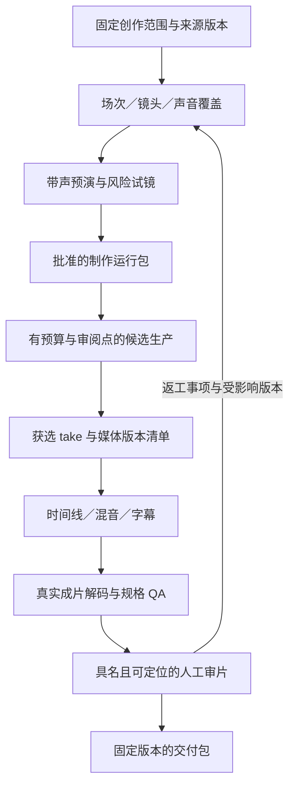

# VSC 短剧／短视频工作流深度审查与改进计划

- 日期：2026-10-11。
- 审查基线：`b31230a`，插件 v0.11.1；13 个阶段、12 个角色、19 个契约、5 个宿主入口。
- 状态：**待评审方案，尚未实施**。本文不改变 Profile、作品基线、创作批准或供应商调用策略。
- 范围：从创作委托、来源与改编，到分集、镜头、资产、声音、候选、剪辑、审片与交付；同时检查返工和跨工具接续。
- 方法：核对技能、角色、Profile、契约、实现和测试；分三个专业视角审查；用临时隔离项目与 FFmpeg 合成媒体离线复现。没有新增付费生成或替现有作品作创作批准。
- 证据：`R` 为离线复现，`S` 为实现／声明核对，`H` 为尚待真实制作或人工观看验证。[观察快照](evidence/2026-10-11-offline-probes.json)保存结果；快照不是作品批准，也不是新增回归测试。

## 1. 判断与改进方向

VSC 已经建立了可靠的版本台账、人工批准边界、生成恢复和部分媒体验证。当前主要问题集中在**不同制作环节之间的交接**：有了场次不等于镜头覆盖完整，生成成功不等于已经选择，时间线里的文件不一定能够回到获选 take，元数据正确也不等于成片完整可解码。

这些接缝在一两镜试验中可由人手补齐；进入多人对白、多场戏、多候选、多集并行和多版本交付时，会同时带来误放行、误返工和重复整理。建议先让一部小样能够有证据地完成，再验证按集滚动生产和轻量短视频入口。新增供应商、扩大素材数量、增加角色数量均不作为第一轮目标。

优先处理四件事：修复成片 QA 的漏检；贯通获选 take 到交付的版本绑定；检查整集场次／镜头覆盖；让连续性检查尊重实际剪切策略和所选候选。

### 已有能力应保留

| 已有实现 | 本次判断 | 保留原因 |
|---|---|---|
| 内核单一声明、宿主入口生成、doctor | 有实现且自检通过 | 五个宿主共用规则，避免不同工具各维护一份流程 |
| 批准快照、完整 SHA、递归依赖、项目锁 | 有实现；检查失败会阻断消费 | 能明确“当时批准了什么”，修订应创建新版本 |
| 按 episode 登记和批准产物 | 有实现 | 不应退回用一份项目级文件宣称全剧完成 |
| 状态时间线、资产参考、镜头锚点、集／场衔接 | 有实现 | 身份与状态有了固定依据，问题在部分消费接口未对齐 |
| 方舟图像／视频、本地程序声音 | 有真实候选证据 | 候选证据与人工选择仍要分开 |
| 云端语音／Seed-Audio 适配器 | 协议和离线测试已实现；真实声音链尚未完成验收 | 凭证存在、权限有效、合成成功、审听通过必须分别报告 |
| 图像／视频队列的全量预检、实际解码、hash 绑定、未知提交停止 | 有实现和离线恢复测试 | 不需要重新发明一套队列或放宽防重复计费机制 |
| 素材库、20 类规格、公开方法、统一检索 | 有实现；规格与媒体已分开统计 | 素材数量和方法数量不能当作制作质量或可交付性的证据 |
| QA 的真实 ffprobe、内容 hash 复检、五类具名审片 | 有实现 | 本轮补齐漏检和定位，不用 AI 自动审美取代人 |

上述结论对应 [内核](../../workflow/README.md)、[版本 ADR](../adr/0002-approved-versions-and-controlled-trials.md)、[工程化制作](../design/engineering-production.md)、[批量生产](../guide/production-batch.md)与[专业制作证据](../governance/production-evidence.md)。

## 2. 按真实制作任务走查

| 制作任务 | 目前能够做到 | 当前暴露的问题 | 应形成的下一步产物 |
|---|---|---|---|
| 把原创创意做成有闭合结尾的单条视频 | brief、来源、改编、剧本与预演都有入口 | 共用改编格式强制集尾 hook；轻量任务仍需逐项拼装完整阶段文件 | 明确单条结尾功能的制作路径、可一次审阅的版本包 |
| 把小说做成连续短剧 | 原文映射、分集产物、episode scope 可登记 | 来源版本未贯通；按集推进视图缺失；整集多场覆盖可漏检 | 来源版本、分集任务板、场／镜头覆盖报告 |
| 做双人对话或动作戏 | 资产、状态、连续性计划、首尾帧均有规范 | 同帧检查误伤正反打；多个 take 由输入顺序隐式选取；音频约束尚未贯通 | 带剪切策略、明确 take 选择和对白时长的预演 |
| 大量生成镜头候选 | 批次预算、依赖、预检和恢复有效 | 正式批准基线未由运行入口核验；依赖候选之间没有人审暂停；声音仍为独立任务 | 绑定批准版本、可在关键候选处等待选择的制作计划 |
| 改一条台词、一个资产版本或背景音乐 | 可创建新产物并声明依赖 | 资产对象不能保持身份更新绑定；声音影响链与统一返工报告不足 | 明确受影响消费者、可保留内容和新增尝试的返工清单 |
| 剪辑并输出可交付成片 | Remotion 计划、剪映草稿、技术和人工审片可运行 | 获选素材与清单绑定不足；部分 QA 假通过；剪映规格丢失；交付迁移依赖本机路径 | 完整成片、固定规格、有效 QA／审片、可迁移交付清单 |

## 3. 问题清单与验收标准

优先级只用于安排改进：`P0` 表示下一次正式交付前应先修复的技术误放行；`P1` 表示单片闭环或连续生产的重要缺口；`P2` 表示入口、迁移与运营改进。它们不是对已有候选或作品的批准／否决。

### F01 · 整集设计 Gate 未验证所有场次和镜头覆盖（P1，R）

**复现。** 在实际 `vsc.novel-serial` Profile 的隔离项目中登记一集两场、两个 sequence、三个镜头；改编与剧本列出两场，只登记第一个 sequence 的 `shot_plan` 和 `sound_plan`，整集 `design` Gate 仍然 PASS。

**原因与影响。** [gate_problems](../../scripts/vsc_state.py#L251)以同 type、stage、scope 存在任一有效批准产物为条件。连续性与声音契约以单 sequence 为单位；[reference_errors](../../scripts/vsc_artifacts.py#L190)验证已列对象，但不计算缺失对象。资产库可按集保存，单 sequence 计划却不能自然代表整集覆盖。缺反应镜头、缺场次或缺声音边界可一直到剪辑时才被发现。

**方案。** 建立集级覆盖清单，引用每场的剧本单元、sequence、镜头与声音计划的确定版本；Gate 检查遗漏、重复和显式省略决定。镜头可以一个覆盖多个叙事单元；是否表达充分仍由导演审看。预演提交同时附带覆盖报告，避免只按镜头数量判断完整。

剧本／分集节拍当前也没有最低结构契约，只有摘要的剧本可被批准并放入导演上下文。应先增加场次、行动、对白／静默、预计时长和叙事单元引用的最小索引，保留自由写作正文；否则覆盖模块没有可靠的待覆盖集合。

**验收。** 两场只交一场必失败并指出缺项；获批的省略决定可以解释范围变化；增加场次或替换剧本后旧覆盖报告需要复核；不要求所有画面使用同一种景别或叙事套路。

### F02 · 来源登记与改编血缘未贯通，新增内容表达也不清晰（P1，R＋S）

**复现。** 原始来源登记后改写或删除，隔离项目的设计 Gate 仍 PASS。`source_units.locator` 可以填不存在的定位而通过格式检查；已经在改编契约声明的新增内容，使用空 `source_refs` 仍被拒绝，只能额外造一个来源单元来满足格式。

**原因与影响。** [source add](../../scripts/vsc_state.py#L425)保存路径与 SHA，但 [Gate](../../scripts/vsc_state.py#L261)只要求来源列表非空；改编 `source_units` 没有强制绑定具体 `S-*` 版本。[改编校验](../../scripts/vsc_state.py#L1054)只检查定位非空及本文件 ID。人工映射仍然必要，但系统目前不能区分“可靠回指原文”“有意新增”和“占位定位”。

**方案。** 来源导入保留受权属允许的版本快照或稳定存储引用；来源单元绑定来源 ID、完整摘要和可解析定位。明确区分原文事实、人物说法、推断和改编新增；新增内容绑定真实改编决定。原始工作路径移动与来源内容改变分别处理，保留旧交付可追溯性。

**验收。** 来源漂移可定位到受影响单元；不存在的段落被报告；人物未证实的说法保持不确定；获批新增不需要伪造原文出处；迁移路径不应使已归档的来源版本凭空丢失。

### F03 · 候选选择、时间线和交付清单缺少同一条媒体版本链（P1，R＋S）

**复现。** `animatic`、`timeline`、`mix`、`delivery_manifest` 的一字符 Markdown 都能通过内容检查；`selected_takes` 也没有专用契约。合法 Remotion 计划引用一个存在的 `source_shot_id`，但没有绑定获选 take、生成记录、声音 Cue 或授权版本，项目引用检查仍通过。错误 episode 的镜头引用目前能够被拒绝，应保留这一检查。

**原因与影响。** [契约目录](../../workflow/contracts.json)未覆盖上述关键交接类型；[content_errors](../../scripts/vsc_artifacts.py#L92)对无专用契约的文本主要做非空检查；[时间线引用检查](../../scripts/vsc_artifacts.py#L218)只核对镜头对象。人工批准仍存在，但批准后缺少机器可核对的“到底用了哪份媒体”。

**方案。** 补齐最小的获选清单、预演、时间线和交付契约。每个媒体段绑定 take／生成记录或手工导入记录、输出 ID、媒体 SHA、裁切区间、选择决定及使用范围；声音和包装使用同样原则。交付清单绑定实际成片、时间线、QA、审片与规格。保留 Markdown 作为给人看的说明，不把它单独当作媒体血缘证据。

**验收。** 未选择候选、换了文件、换了裁切、混入别集 take、使用过期授权版本都能定位；改背景音乐不要求重做所有人物图；无法选择的低质量候选可以如实留档。

### F04 · 成片技术 QA 存在可复现的误放行（P0，R）

**复现。** FFmpeg 合成两秒 MP4 后破坏视频负载，ffprobe 仍能读出元数据，`check_plan` 和 `validate_report` 都通过，实际 `ffmpeg -xerror` 解码失败。两秒视频配一秒音频，计划要求两秒音频，报告仍通过。另将不符合实测的响度目标写入报告，`validate_report` 未按这个目标复核；同一目标直接传入 `check_plan` 则会失败。

**原因与影响。** [check_plan](../../scripts/media_qa.py#L160)主要依据元数据、总时长和音轨存在性；[validate_report](../../scripts/media_qa.py#L250)重建报告时没有传入 `loudness_target`。已有 hash 防漂移有效，但它无法证明原来登记的字节完整可解码，也不能替代音频覆盖和目标复检。

**方案。** 将成片完整解码作为正式交付的技术条件；长片以有界执行、进度和明确超时处理，不能用抽帧通过冒充完整解码。检查计划要求的实际音频覆盖区间。交付规格绑定响度／真峰值目标，报告复检使用同一规格与测量规则；保留主动静音的合法场景。

**验收。** 损坏负载、音轨提前结束、不符响度／真峰值分别失败；计划中的合法静默通过；源媒体和成片都保留 SHA；无解码器、超时或测量失败显示未验证，不显示通过。具体响度值由作品交付规格决定，不预设为所有平台的统一标准。

### F05 · 人工审片有具名记录，却缺少可解析的证据位置（P2，R）

**复现。** 五类审片的 evidence 都填 `99:99 SH-NOT-IN-PLAN`，仍能通过 [validate_review](../../scripts/media_qa.py#L286)。当前验证了非空证据和报告版本，没有验证该时间点或镜头是否属于实际成片。

**方案。** 保留人工判断，将 evidence 拆成时间区间、镜头／片段 ID 和观察说明，绑定成片 hash。可以审查全片，但需显式标记全片范围。创作问题形成带最早责任阶段的修改事项。

另外区分样片评测、完整单集审看和具体交付版本审看；一段样片即使镜头都属于本集，也不能证明其余镜头已经审过。横版与竖版、不同字幕／语言版本的审看范围分别登记。

**验收。** 越界时间、不存在的镜头和错误成片版本被拒绝；修订后旧意见保留并标注解决版本；程序只检查定位有效，不宣称证明人的意见真实或审美正确。

### F06 · 连续性把“剪切”误当成“同帧续接”，多个 take 的选择依赖输入顺序（P1，R）

**复现。** [chain_problems](../../scripts/consistency.py#L710)对同场相邻镜头一律要求尾帧 SHA 等于下一镜首帧 SHA，不消费 hard cut、反应镜头等桥接策略。另把同镜头的已选／未选两份记录调换顺序，结果会在 FAIL 与 PASS 之间改变。

**原因与影响。** 视频记录按 `shot_id` 放进字典，后输入覆盖先输入；检查对象没有固定为获选 take。相同像素要求适合同一构图连续生成，不适合所有正反打、插镜、主观镜头和蒙太奇。它可能使制作人为通过检查而牺牲合理剪辑。

**方案。** 连续性接口消费获选清单和正式桥接策略。同帧续接检查首尾帧；动作衔接检查声明的动作、位置、方向与手柄；正反打检查空间、轴线、视线及反应；省略和换场检查有意变化及叙事承接。多候选没有明确选择时报告歧义。

**验收。** 已选集合不变时调换输入顺序结果不变；正常正反打可通过相应检查；同帧续接错帧仍失败；动作方向或手持物错位给出具体责任字段；实际情绪与表演继续人工审看。

### F07 · 资产身份无法在保持 ID 的前提下更新批准版本（P1，R）

**复现。** 资产 v1 已批准并绑定 asset 对象；v2 使用 `--supersedes` 可批准，但再用原对象 ID 绑定 v2 被拒绝。旧连续性计划随即因资产绑定 v1 已被替代而失效。新建 ID 能绕行，但会扩大人物／道具身份修改范围。

**原因与影响。** [object add](../../scripts/vsc_state.py#L913)只支持新增和列表；[参考资产检查](../../scripts/vsc_artifacts.py#L179)消费对象当前绑定的产物，未将身份和按运行固定的版本分开。

**方案。** 保持稳定身份，为新运行明确绑定新资产版本；旧批准产物继续保留原版本的历史依据，当前制作的失效与历史存档区分。建立显式版本调整与影响报告，不提供无记录的就地改写。

同一实体的参考图还需声明适用变体和用途。额外离线反例中，状态穿雨衣，只使用默认服装整身图，检查仍通过，锚点同时装入两套服装图。应区分通用脸部身份参考与服装／昼夜等专用参考，避免已有的变体文字与实际图像脱节。

**验收。** 同一人物 ID 可用于 v1、v2 的不同批准制作版本；旧记录可回查，新的消费不会偷偷沿用失效版本；只涉及该变体／身份的消费者进入复核，不要求重命名整个作品。

### F08 · 多模态参考在供应商与连续性模块间被压成同一种引用（P1，R）

**复现。** 合法 `ref_audio` 与 `ref_video` 可经离线模拟供应商队列成功，并写入生成记录；之后 [record_problems](../../scripts/consistency.py#L565)将它们与人物／场景图片参考集合比较，报两条“不属于本镜”错误。即使音频已经登记为资产的 sound，也未被正确分类消费。

**方案。** 参考输入区分媒体类别和用途：身份图片、构图、动作视频、声音、首帧、尾帧等，分别绑定对象、版本与 SHA。适配器保留真正送入模型的输入语义；校验器按用途判断允许范围，声音参考不能替代角色身份图片。

**验收。** 合法的多模态请求在生产与连续性检查中结论一致；错误角色／来源和遗漏身份参考仍失败；旧记录有显式兼容或迁移方式，不靠把所有媒体加入图片参考来消除错误。

### F09 · 底层队列与正式制作批准之间缺少运行接口（P1，R＋S）

**复现。** 隔离输入的 `vsc.json` 只有 project_id，三个依赖 job 仍能完成离线执行，三份 `selection` 均为 null，下游已消费上游候选。队列没有改写项目批准，这是正确且公开声明的限制。

**原因与影响。** [build_plan](../../scripts/vsc_production.py#L137)验证请求、输入、预算与项目标识，不解析有效批准的镜头／资产／声音版本；[run](../../scripts/vsc_production.py#L357)按技术成功连续派发。计划 hash 绑定请求，不能证明正式制作所需的批准已齐备。技术依赖与创作选择之间目前靠编排者手工连接。

**方案。** 保留底层候选工具，增加正式制作入口：消费已批准范围和预算，导出固定运行包，调用现有适配器。关键资产、关键帧或高风险动作可设置等待选择；允许负责人明确授权一批候选连续探索，但将其标为试验并限制传播成本。

恢复也需补两项：方舟视频目前存在无本轮 deadline 的持续轮询，外层调用次数上限不能限制一次调用内部的查询；已知原任务仅需恢复下载时，过期输入 URL 改为 data URL 会改变请求编码并拒绝续接，即使语义输入字节未变。前者由静态实现确认，后者已离线复现且没有新增创建调用。应固定首次请求凭证，区分新提交与原任务查询／下载，并采用有界轮询；保持未知提交不自动重提。

**验收。** 正式运行输入无批准、已失效或范围不符时，在首个付费请求前停止；带人审点的下游不提前执行；重启后恢复同一等待事项；试验模式不伪装为正式批准；未知提交继续禁止自动重提。

### F10 · 分集产物已有 scope，进度和 Gate 仍只有全剧视图（P1，R）

**复现。** 两集项目中第一集剧本获批、第二集尚未完成时，`next` 返回 script，`gate check script` 仅报告第二集缺项；`gate check ... --scope EP-1` 不被识别。第一集的设计产物可以按其剧本正常批准，说明问题在推进接口，不能据此声称第一集完全无法制作。

**原因与影响。** [gate_problems](../../scripts/vsc_state.py#L251)遍历所有 episode，[first_open_stage](../../scripts/vsc_state.py#L282)只返回一个最早阶段，[CLI](../../scripts/vsc_state.py#L1317)没有按集状态／Gate 查询参数。边播边做、先验收试集和局部返工都需要人工重建任务视图。

**方案。** 提供按集的状态、下一步和验收查询，保留全剧完整性 Gate；分别列出共享基线与本集依赖，形成可并行的制作任务板。列出相邻集承接约束，不能因为本集单独通过而忽略系列基线。

**验收。** 第一集可显示下一步设计，第二集仍显示待剧本，全剧检查仍 FAIL；更新共享人物版本能列出受影响集；新增集不会把已完成集的状态说明混为未制作。

### F11 · 批次规模上限尚不能控制全项目制作成本（P1，R＋S）

**已有能力与缺口。** [批量生产](../guide/production-batch.md#预算与恢复)明确只限制批次图像数、视频秒数和调用次数，金额为未知；批次锁按 batch ID 隔离。参考架构中的预算预留、已花费、未知费用与对账是候选设计，尚未形成项目共享账本。多个批次、独立语音和被否决候选不能由单批额度统管。

隔离项目先后执行两个各含一张图、十秒视频的合法批次，均成功，总计两张图、二十秒视频；各 journal 只反映自身上限。这确认额度归属单批，不证明任何真实货币预算已经超支。

**方案。** 先建立本地项目共享的用量／费用账本，记录估算、预留、已确认和待对账；图像、视频、语音与人工导入费用进入同一范围。没有可靠报价时只承诺可验证的原生用量上限，货币金额保留未知或要求人工报价，不虚构单价。先验证本机原子预留，再讨论分布式执行。

**验收。** 两个批次争抢同一剩余额度，不能同时各花全部余额；创作否决保留已产生成本；技术轮询不被当作新候选；未知提交不释放可能已发生的支出；账本可按集和镜头汇总，并保留供应商计费单位。

### F12 · 声音已能单独制作，尚未贯通对白、表演、视频与后期（P1，R＋S＋H）

**已验证。** 资产 voice／sound 有字段，语音请求有 speaker、资源、参数与输出记录；声音 Cue 和时间线支持跨镜音轨。修改 voice 或 sound，不会改变当前视觉锚点 hash。这对静音画面未必是错误，不能通过把所有声音塞进视觉 hash 来修复。

**缺口。** [anchor_pack](../../scripts/consistency.py#L335)只提取视觉身份等字段；图像／视频队列不编排声音任务。对白行、试读时长、停顿、表演节拍、声线版本与原生音画视频之间缺少统一的消费者绑定。固定 speaker 参数也不能证明听感、情绪和口型一致。

**方案。** 以稳定对白行 ID 绑定说话人、剧本版本、实测时长和选中音频；先做试读与带声预演，再固定镜头节拍。原生音画、后配音、旁白、无对白明确分路；涉及声音的消费者才依赖音频版本。声音桥使用最终时间线位置，保留环境底和音乐的跨镜连续。

表演也需最小的可累积状态：当前实体状态主要是变体、位置、持有物和 note，姿势／视线／朝向没有相同执行语义，note 也不会自动进入标准关键帧文字。应选取实际需要的世界状态字段，区分人物世界朝向与摄影机相对的屏幕方向，再映射到镜头输入；不复制所有文档字段。声音方面增加 Cue 到实际音轨的联合复核，发现声明 J/L cut 却没有实现、环境底掉落或 BGM 每镜重新起等问题。

**验收。** 修改一行台词或声线，影响音频、口型、混音及必要的原生音画镜头；未涉及的静音图像可保留。两人对白的轮次、停顿与可懂度有实际审听证据。云端权限未就绪时可先做本地临时音频验证，但正式云端声源验收继续标为待完成。

### F13 · 剪映导出改变帧率和 composition 总时长（P1，R）

**复现。** 24 fps、两秒 composition，画面段一秒、末尾计划留黑一秒；实际导出的剪映草稿为 30 fps、一秒，`dropped` 为空。[draft_payload](../../scripts/jianying_export.py#L34)未传 fps／总时长，[build_draft](../../scripts/jianying_export.py#L97)按片段末端重算，底层模板默认 30 fps。

**方案。** 导出器固定 composition 的帧率和总时长，显式表示尾部留黑或留白。支持不了的规格／片段拒绝或列明损失，不静默改变。已有淡入淡出、关键帧和图片不迁移的警告继续保留；导出后的实际剪映回看仍是必需验证。

字幕列为同一导出工作包：当前 SRT 容错解析可无提示跳过坏块，也未在烧录入口核对所有字幕与成片时长；Remotion、剪映没有共同消费资产库的字幕样式。共享 cue、时序、样式／字体与安全区解析，交付时列出坏块和越界字幕，不让预览容错掩盖缺字幕。坏块跳过与 90–91 秒字幕被接受已离线复现；真实烧录和不同导出器的画面保真仍待验。

**验收。** 24／25／30 fps 和非整数帧率有明确支持矩阵；不支持项先拒绝。片尾黑场、字幕尾和声音尾保留，时间点与原计划在声明精度内一致。离线草稿正确不等于已在剪映 UI 验收。

### F14 · 单条短视频与连续短剧共用部分叙事要求，轻量入口仍偏重（P2，R＋S＋H）

**复现与判断。** 单条原创视频即使结尾完整、不需引出下一集，删除 `exit_hook` 仍不能通过共用改编校验。填写“故事已结束”可绕过非空要求，但没有表达真实的结尾功能。多个 Profile 已存在，阶段数量和前置依赖仍十分接近；这些事实说明可改进入口，不能推断所有创作者都认为步骤过多。

**方案。** 分清单条兑现／余味、连续剧本集兑现／集尾期待、品牌信息／行动等目标；结构不强制套用反转或悬念。先用已有 Profile 配置和契约变体表达差异，再决定是否新增轻量 Profile。允许一次审阅同一固定版本包中的相关创作选择，保留每项选择和依赖证据。

**验收。** 有闭合结尾的原创短片可诚实登记；连续剧保留集尾承接；无对白、旁白和对话片均有明确路径。用小样记录实际填写、修改、审阅次数，再决定删减哪些步骤；不以减少检查数作为唯一成功标准。

### F15 · 旧作品不能显式迁入新的工程化 Profile（P2，R）

**复现。** schema 3 的旧 Profile 项目运行 `migrate --accept-current-profile`，只补目录说明，Profile 与 hash 保持原样。当前 migrate 处理 schema 1／2 迁移，没有同 schema 的 Profile 迁移接口。固定快照本身是应保留的设计，不能直接修改快照来升级。

**方案。** 增加可预览的 Profile 迁移提案：显示新增 Gate、缺失产物、仍可保留的版本、需复核范围和回退点；负责人选择后才应用，记录新快照与迁移事件。

**验收。** 旧项目先只读看到差异；迁移无隐式批准、无丢失历史；新增声音／状态／衔接要求清楚列出；取消迁移不改变状态；旧交付仍能按其原始依据追溯。

### F16 · 交付证据依赖本机路径，缺少可迁移的完整交付包（P2，S＋H）

**已有能力与缺口。** 审片快照会复制相对 QA 报告，但 QA 内的计划、media_root 和成片仍为本机路径。[专业制作证据](../governance/production-evidence.md)已明确移动后需生成新报告。素材库能按 SHA 复用，现有机制尚未形成带全部依赖和规格的独立作品交付包。

**方案。** 先做本地离线交付包：相对媒体清单、实际成片与字幕、时间线、必要参考、QA／审片与选择决定的版本清单、交付规格和权属引用。根据授权决定包内放媒体还是稳定引用；迁移后验证内容与映射。预览、母版、竖／横版、字幕版分别有明确交付 ID。

可编辑工程同时归档 Composition／草稿版本、代码摘要、依赖锁、工具版本、渲染参数及输出摘要。手工精剪变更应回写或另登记版本；计划 QA 不能单独证明后来修改的工程仍与计划一致。重导先验证帧数、素材选择、字幕和混音语义；编码环境无法保证逐字节相同时明确说明，最终发行文件仍绑定自己的 SHA。

**验收。** 复制到新目录、断开原目录后可完成依赖检查与必要复检；缺文件、过期引用、错误版本明确失败；多比例版本的字幕／主体安全区须分别回看；不把本地打包等同于发布平台已接入。

## 4. 方案结构：加深交接模块，保留当前内核

继续遵循 [ADR-0001](../adr/0001-workflow-kernel.md) 的单一内核和 [ADR-0002](../adr/0002-approved-versions-and-controlled-trials.md) 的确定批准版本。以下均为候选设计，不是已经存在的命令或契约。

| 模块与接缝 | 拟议的小接口 | 实现应隐藏的复杂度 | 局部性与杠杆 | 本轮不扩大的范围 |
|---|---|---|---|---|
| 创作范围与覆盖 | 对指定集／场检查输入版本及覆盖 | 对象树、场次、镜头、声音和省略决定对齐 | 同一报告用于预演、生产和返工 | 不自动评价故事好坏，不建立庞大故事推理系统 |
| 候选选择与媒体消费 | 从批准选择清单解析时间线输入 | take、生成记录、SHA、裁切、使用范围 | 一次修复覆盖 Remotion、剪映和交付 | 不建立全功能在线编辑器 |
| 连续性 | 对选定镜头边界按策略检查 | 同帧、动作、轴线、换场及声音桥的不同规则 | 减少正确镜头被误退回 | 不以像素相似替代表演／情绪判断 |
| 正式制作运行 | 固定运行包，在依赖／审阅点推进 | 批准、预算、队列、等待、恢复、候选登记 | 沿用现有方舟和声音适配器，两个实现证明接缝有效 | 不先上分布式调度引擎 |
| 交付验证与打包 | 对固定交付 ID 检查并生成包 | 成片解码、规格、QA、审片、依赖迁移 | 一次验收复用于多宿主与不同导出器 | 不自动对外发布 |

不能靠删除现有产物／版本模块来减少表面复杂度：删除它们会让复杂度回到所有调用者。应优先把交接所需的重复知识收拢到上述接口背后，再更新技能入口，避免再叠加一套与当前 CLI 并存的事实来源。

## 5. 实施顺序与退出条件

按依赖和可验收结果推进，不在缺少真实样片数据时承诺日历工期。每个工作包开始前确认范围，行为变化补测试、版本和发布说明；完成后按维护流程运行完整 CI，并用暴露问题的案例重跑。

| 顺序／工作包 | 对应问题 | 主要产物与改动归属 | 退出条件 | 依赖 |
|---|---|---|---|---|
| W1 · 交付技术修正 | F04、F13 | `media_qa.py`、剪映导出器及故障回归；固定交付规格与字幕检查规则 | 损坏媒体、缺音频尾、响度不符均失败；帧率和片尾不静默丢失；字幕坏块与越界可见 | 可立即开始 |
| W2 · 最小创作与媒体交接契约 | F01、F02、F03、F05 | `workflow/contracts.json`、模板、产物校验器；范围覆盖、来源版本、获选清单、预演、时间线／交付清单及结构化审片 | 一集两场完整覆盖；所有成片输入可回到批准版本；证据时间可定位 | W1 提供可靠 QA |
| W3 · 资产与连续性修正 | F06、F07、F08 | `consistency.py`、对象版本绑定、引用契约与适配器映射 | 正反打、同帧续接、多 take、多模态和资产 v2 均有正反例 | W2 的选择清单 |
| W4 · 正式运行与项目预算 | F09、F11 | 在既有队列之上增加批准运行包、审阅暂停、候选导入与本地共享账本 | 无效批准不调用；关键候选待选时停止下游；并发批次不超共享上限 | W2、W3 |
| W5 · 声音与表演闭环 | F12 | 对白行绑定、试读与带声预演、音画路线、Cue 到时间线映射 | 两人对白试片通过审听；改台词／声线仅影响必要消费者 | W2；正式云端验收需有效权限 |
| W6 · 按集滚动与显式迁移 | F10、F15 | 按范围状态／Gate／下一步；迁移预览和影响报告 | 一集进入制作时另一集可以继续写作；全剧不被误报完成；旧项目可选择升级 | W2、W3；制作自动推进依赖 W4 |
| W7 · 轻量入口与交付包 | F14、F16 | Profile／契约差异、版本包审阅、本地打包与迁移检查 | 闭合单条与连续剧分别可跑通；新目录可复检交付包 | W1–W6 的代表性验收 |

建议先完成 W1，再以 W2＋W3＋W5 形成最小单片闭环；完成真实小样后，再扩大 W4／W6。W4 的共享预算模型可并行设计，不能先用大批量付费生成来验证还未接好的创作交接。

## 6. 用作品验证，而不是只用测试数量验证

以下是拟议验收样例与阈值，需在实施前由负责人确认；不构成新作品委托或生成预算。

### 样例 A：独立叙事短视频

采用有闭合结尾的 45–90 秒小样；建议两个人物、至少两场、正反打／反应／插镜、独立对白和跨镜环境底。具体时长服务于样例覆盖，不是平台硬规定。先用临时素材和试读完成预演，再对最难的身份、递物、对白／口型边界做小规模试镜。

- 硬性工程条件：所需场次和镜头覆盖无未解释缺项；所有使用媒体可回到获选版本；无解码错误、超范围裁切或错误规格；QA 与人工审片绑定同一成片。
- 人工创作条件：不看来源也能说明人物目标、阻碍和关键选择；动作、视线、反应和声音桥成立。观看人数及判据应在试验前确定，不能看完再挑指标。
- 变更试验：改一条台词、换一段音乐、改一个服装变体、改片尾字幕，记录应重做、实际重做和漏改的消费者。

### 样例 B：三集连续短剧的滚动生产

至少两集共用一个角色／场景，包含跨集叙事承接、有意时间省略和一次共享资产版本变更。第一集完成带声预演时，后续集仍可在剧本阶段；全剧保持未完成。

- 每集有自己的有效状态和交付范围；共享基线与相邻集承接可见。
- 正常剪切不被同帧规则误判；同镜头多候选的记录顺序不影响检查。
- 资产 v2 可保留身份并明确影响范围；旧版可追溯，待复核事项不丢失。
- 多批次、声音任务及否决候选的用量进入同一项目账本。

### 样例 C：无对白／旁白主导的轻量短视频

使用已有素材或受控图形，不强制每镜都调用视频模型；保留一个真实创作目标和可打开的成片。验证轻量路径是否减少无效填写，同时保留来源、选择、声音、字幕和交付证据。多比例版本如需交付，分别检查主体与字幕安全区。

### 必须覆盖的故障与返工用例

| 用例 | 期望结果 |
|---|---|
| 一集两场只交一场计划 | 范围检查失败并列出缺失场次／sequence |
| 来源内容改变或定位不存在 | 显示来源版本与受影响单元；不偷偷当作旧依据 |
| 已批准新增内容没有原文定位 | 使用改编决定回指，合法通过 |
| 未选 take 或替换媒体字节进入时间线 | 选择／SHA 检查失败 |
| 两份同镜头 take 调换输入顺序 | 选择不变，结果不变；无选择时报告歧义 |
| 正反打使用不同关键帧 | 按剪切策略验收；不强制同一像素 |
| 同帧续接故意错帧 | 保持失败 |
| 角色资产 v2 替代 v1 | 同身份可显式换版本，历史可追溯 |
| 雨衣镜头只给默认服装整身图 | 报告不适用变体，通用脸部参考仍可复用 |
| 音频与视频参考混合输入 | 用途分类一致；越权／错身份仍失败 |
| 正式运行无有效批准 | 首个外部调用前停止 |
| 上游候选等待人工选择 | 下游暂停；进程重启后仍能恢复 |
| 请求已受理而本地响应丢失 | 保持未知并先对账，不重复创建任务 |
| 供应商一直 processing／输入 URL 已过期 | 本轮有界退出；有原任务凭证时查询／下载续接，不重新提交 |
| 两个批次争用余额 | 原子预留，项目总上限不被突破 |
| 损坏 MP4 保留完整文件头 | 完整解码失败，不能交付 |
| 两秒声音计划、实际仅一秒音轨 | 覆盖检查失败；计划静音区间例外 |
| 报告更改响度目标 | 用固定规格重新测量，不能忽略目标 |
| 审片时间越界或镜头不存在 | 证据定位失败，保留原意见待更正 |
| 剪映 24 fps＋片尾留黑 | 保持帧率和完整总时长，或先明确拒绝不支持项 |
| SRT 坏块、越界字幕或错误样式版本 | 明确报告并阻断相应交付，预览容错不能作为验收依据 |
| 第一集已完成、第二集未写完 | 按集状态准确，全剧仍未完成 |
| 交付包迁移且原目录不可用 | 依赖完整可复检；缺文件明确失败 |

### 记录哪些真实制作数据

分别记录：首次合格候选率、最终镜头接受率、每个获选镜头的全部收费尝试、试读／生成／等待／审阅／返工耗时、人工填写与选择次数、实际局部重做集合、来源／连续性／交付问题数。未知金额保留未知；不把“少花钱但漏改关键剧情”算作改善。

现有 356 项测试及本地 CI 证明了一批软件行为，不能证明本方案的三个样例已经通过。真实观看、供应商权限、正式云端声音、剪映 UI 回看、Remotion 实际渲染和独立目录交付仍须各自保留证据。

## 7. 兼容与实施约束

- 本轮仅提交方案与去项目化证据，不新增能力声明或修改已批准作品。
- 新契约优先补齐关键版本链，避免一次把所有创作文档改造成大而全的 JSON；先支持最小单片，再由多集样例检验扩展。
- 契约／行为变更需版本化、测试、迁移说明及真实案例复跑。旧作品不能静默套用新 Profile，旧交付不能被就地改写。
- 批准留给真实负责人。可以在一次审阅中确认一组明确版本，不得用批处理或 AI 自评隐含批准。
- 已有未知提交保护、密钥不回显、输入路径限制和实际媒体检查继续保留。缺钥时沿用 `~/.zshenv` 定位提示；加载不到与认证失败保持区分。
- 公开方法和规格库用于提供候选方法。项目效果仍需试用和可比评测，不能把公开概念直接晋升为已验证的创作能力。
- 本地 CI 当前的 `projects` 检查只确认作品仍能被状态机读取，不要求未完成作品 Gate 全部通过。改进时应新增隔离的制作链回归，不把真实未完成作品错误地当作 CI 失败。

## 8. 复现记录与证据边界

离线复现使用临时项目，批准标签明确是 synthetic fixture；未更改真实作品的创作内容或批准。架构任务包通过现有 context CLI 建立，仅作为审查任务记录。公共观察快照不包含作品原文、人物、媒体、账户凭证或本机绝对路径。

| 证据组 | 做法 | 关键结果 |
|---|---|---|
| 故事与范围 | 真实 CLI 建一集两场；只交一场的分镜／声音计划；修改／删除来源 | 设计 Gate 三次 PASS；不存在定位 PASS；明确新增但空 source_refs FAIL；单条省略 exit_hook FAIL |
| 分集推进 | 复用 `test_vsc_integrity.py` 的两集 fixture，补第一集设计产物 | 全剧 next=script，按集 Gate 参数不存在；第一集设计产物可批准 |
| 资产与候选 | 真实 CLI 替代资产；相同 take 集合改变记录顺序；模拟现有适配器 | 同身份重绑失败；链检查结果受顺序影响；多模态生产成功而后续连续性报错 |
| 交付技术 | 真实 FFmpeg 合成 MP4／音频，损坏负载、缩短音轨、改变响度目标 | 损坏负载与过短音轨仍被 QA 放行；响度复检丢失目标 |
| 剪映 | 实际写入临时草稿目录，不打开真实用户草稿 | 24→30 fps；两秒→一秒；没有规格丢失警告 |
| 审片定位 | 使用通过技术检查的合成媒体，填写不存在的时间和镜头 | 审片结构校验仍通过；不据此推断任何真实审片人存在虚假行为 |
| 依赖规模探针 | 按 engineered-short 的前阶段全依赖构造 16 个节点，隔离内容／引用检查，保留真实 SHA 读取 | 检查一个末端版本发生 52 次内容入口／hash 读取；仅证明重复遍历，不证明实际多集制作已出现性能瓶颈 |

依赖规模目前列为待测项：在多集样例记录 Gate、状态、上下文构建的耗时和校验次数，再决定是否使用单次操作内的 memoization。不能跨操作缓存过期 hash 或批准状态，也不应在尚未测出瓶颈时先重写状态模块。

审查没有联网调用供应商、获取新单价或核实平台当前交付规则，因此没有给出最新模型能力、统一响度标准、真实预算金额或工期保证。下一步实施优先从 W1 的可复现技术缺陷开始。
