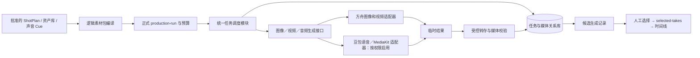

# VSC 生成与素材关系升级方案：单平台接入，多平台抽象（执行模块候选）

- 日期：2026-10-13。
- 状态：**执行模块候选，尚未实施或批准付费试产**。面向每集约 3 分钟、60 集以上的总体设计已由[连续短剧工作流升级方案](2026-10-13-serial-drama-workflow-upgrade.md)取代。本文件的 Provider、任务恢复、预算和媒体转存部分保留供实施参考；其中“数据库仅作任务／媒体索引、`vsc.json` 长期保持新项目权威”的选择已被总体方案修订，不能单独据此实施。本文依据用户提供的火山方舟方案及 [drama-skills 对标审查](2026-10-13-drama-skills-benchmark.md)，以当前 VSC v0.12.0 的实现为起点。涉及真实作品、供应商权限、声音权利、预算和创作选择的决定仍由项目负责人作出。
- 一句话目标：**业务层只消费稳定的 VSC 创作规格和素材身份；调度模块负责受控任务；火山方舟是第一个生成适配器。** 第二个适配器应能接入同一任务与素材接口，不要求修改剧本、镜头、批准和剪辑语义。
- 本轮交付是升级设计与实施顺序，不声明数据库、对象存储、统一 Provider 接口或云端音频已经上线。仓库当前未见关系数据库 schema；示例中的“已有关系型数据库”不是 VSC 仓库的已实现能力。用户已明确希望把关系库作为新系列工作流的结构化主干，具体迁移方向见[总体方案](2026-10-13-serial-drama-workflow-upgrade.md)。

## 1. 现状、问题与保留的权威

| 现有实现与证据 | 保留的职责 | 待补的接缝 |
|---|---|---|
| [`vsc.json`](../../scripts/vsc_state.py)、固定产物快照、Profile 与 Gate；[production-v2](../../workflow/production-v2.md) | 项目状态、批准版本、范围与人审决定的权威 | 数据库查询须回指批准快照的 ID、SHA 和 scope，不能自立批准状态 |
| [`vsc_run.py`](../../scripts/vsc_run.py)、[`vsc_budget.py`](../../scripts/vsc_budget.py)、[`vsc_production.py`](../../scripts/vsc_production.py) | 正式 run、共享原生单位预算、批次依赖、人审暂停、未知提交不重发 | 将付费提交和恢复纳入统一 job 身份；避免旧 journal 与新数据库双主写入 |
| [`volc_ark.py`](../../scripts/volc_ark.py) 与 [`vsc.generation-record/v1`](../../templates/generation-record.json) | 方舟实际请求、原任务续查、原始响应、下载、输出 SHA | 从业务调用点隔出请求编译和图像／视频适配器；记录任务与素材的可查询关系 |
| [`doubao_speech.py`](../../scripts/doubao_speech.py)、[`doubao_audio.py`](../../scripts/doubao_audio.py) | 不同凭证、端点、调用方式及现有失败证据 | 按实际语音／MediaKit 能力单独适配；当前 401 与未配凭证不能写成“火山音频已跑通” |
| [素材库](../guide/reuse-and-search.md)、selected-takes、timeline | 素材权属、获选输出、媒体 SHA 与剪辑绑定 | 用稳定媒体 ID 关联镜头／资产／声音用途，支持按集、场、镜、角色和来源查询 |

采用 [ADR-0001](../adr/0001-workflow-kernel.md) 的模块化单体、[ADR-0002](../adr/0002-approved-versions-and-controlled-trials.md) 的固定批准版本及 [ADR-0003](../adr/0003-production-handoffs-and-approved-runs.md) 的正式制作入口。数据库是**执行与媒体索引模块**，不替换工作流内核或让 SQL 行代替人工批准。若未来决定把项目状态整体迁入数据库，另立迁移方案与 ADR，不在本次顺手双写。

## 2. 模块与接口



这里的统一接口是**小接口加完整行为约定**，不是把三个 SDK 的所有参数塞进一个大 JSON。业务调用 `submit(logical_request)`；调度模块选择已验证模型、编译供应商请求并持久化提交意图；适配器负责 `submit`、`poll`、`parse_result` 和必要的 `recover`。同步图像返回也规范成同一 `JobHandle` 与终态；异步视频继续按原任务编号续查。回调可作为状态输入，但不能代替轮询与对账。各模态用类型化请求和能力校验，适配器输出统一的 `JobStatus`、`GeneratedAsset`、错误类别及原生用量证据。

接口必须写明：输入版本与 SHA、参考素材角色、幂等与超时语义、状态迁移、错误分类、媒体落地条件、权利限制及成本单位。**一个方舟适配器只能证明接缝可实现；等第二种实际实现接入时，再用同一契约验证可替换性。** 不先造复杂通用路由引擎。

### 2.1 逻辑素材包

沿用 VSC 的 ShotPlan、资产库、状态时间线、锚点包、声音 Cue 和固定版本依赖，新增一个只读的、版本化的镜头或资产级逻辑素材包视图。它由**已批准**规格导出，不反向覆盖原产物。示例：

```json
{
  "format": "vsc.asset-bundle/v1",
  "target": {"type": "shot", "id": "SH-005", "artifact_id": "A-0123", "sha256": "<approved-sha>", "scope": "EP-001"},
  "purpose": "shot_keyframe",
  "modality": "image",
  "prompt_intent": "<镜头意图与可见事实>",
  "negative_constraints": ["<不得改变的身份或状态>"],
  "canvas": {"aspect_ratio": "9:16", "target_width": 1080, "target_height": 1920},
  "references": [
    {"asset_id": "CHAR-001", "version_sha256": "<sha>", "role": "identity_face"},
    {"asset_id": "LOC-002", "version_sha256": "<sha>", "role": "location_master"}
  ],
  "continuity": {"anchor_sha256": "<sha>", "entry_frame": null, "exit_frame": null},
  "style_ref": {"id": "STYLE-01", "version_sha256": "<sha>"}
}
```

`asset_id` 不是方舟 `asset://`；需要供应商可信引用时，由适配器根据实际账号、原始产物和时效解析。`prompt_intent` 是创作意图，模型方言及参数在已选模型的请求编译器中生成。用户示例中的 `provider_policy.preferred` 与 `style.model_hint` 应进入 **production-run 的执行策略快照**，而不是镜头、资产库或上述包的创作语义。`seed` 可作为执行尝试的可选参数留档，但不能承诺跨模型逐像素复现。

### 2.2 模型能力与路由

首期只登记实际可用的图像和视频模型、实际凭证类型与能力测试结果；语音／MediaKit 分开标注 `offline_tested`、`auth_failed`、`unconfigured` 或 `online_verified`，不能合并成一个“火山音频可用”。模型条目记录供应商模型 ID、可获得的版本、参考图角色、首尾帧是硬约束还是提示、输入上限、输出格式、同步／异步、计费原生单位、账号／地区及复核时间。能力未知即阻断对应请求或做显式人工选择。

首期路由配置可以只有一条明确的 `purpose × modality → model` 映射，并随 run 固定快照。以后若出现真实的第二个平台，再增加 `provider_routes` 持久表和显式 fallback 策略；**不能仅加一行路由就假定素材权利、输入语义、画质、成本与审批结果等价**。创作结果会变化的 fallback 需重新预览请求并获相应决定。

## 3. 数据与素材关系

媒体字节保存在项目可控文件系统或对象存储；数据库保存关系、固定引用、状态与审计。首个部署可用满足事务、唯一约束和备份的关系数据库；若用户已有外部数据库，优先核对其实际 schema 和运维能力再选迁移方式，不在方案中假定 PostgreSQL 或 MinIO 已配置。下表为**逻辑模型**，`jsonb` 仅在选用 PostgreSQL 时成立。

| 逻辑表 | 关键字段与关系 | 规则 |
|---|---|---|
| `generation_jobs` | `job_id`、`run_id`、`target_type/id`、批准产物 `artifact_id/sha/scope`、`purpose/modality`、`candidate_no`、`provider/model/version`、`request_hash`、`status`、`external_task_id`、`created_at/updated_at` | 一行代表一次**有意的远程生成提交**；供应商任务 ID 只存于执行层。`(run_id, target, purpose, candidate_no)` 唯一；再次创意抽样分配新的 candidate_no |
| `job_requests` 或不可变请求快照 | `job_id`、逻辑包 SHA、编译器版本、模型能力快照、实际请求、输入媒体 ID/SHA/角色、认证引用、seed/参数 | 在项目授权范围内保存完整请求；密钥与签名 URL 的秘密部分只存受限引用／摘要。实际请求 hash 与提交时绑定，之后不改写 |
| `job_events` | `job_id`、事件来源、来源事件 ID／响应摘要、状态、时间、原生用量与错误类别 | 回调、轮询、下载、对账均可追踪；重复／乱序事件不倒退状态 |
| `media_assets` | `media_id`、`storage_uri`、`sha256`、媒体类型／规格、来源类型、权属引用、校验状态、创建时间 | 统一索引**生成与手工导入**素材；`storage_uri` 指向经控制且已核对字节的永久副本，不能是临时方舟 URL |
| `job_outputs` | `job_id`、`provider_output_id/role`、`media_id`、原始链接留档引用、转存状态 | 一个任务可产多个图、视频、尾帧或音轨；原始 URL 与期限在受限执行记录中留档，仅作溯源／续接，不作长期播放地址 |
| `media_bindings` | `target_type/id/version_sha`、`media_id`、用途、take ID、选择产物 `artifact_id/sha` | 一个镜头可有多个候选；只有已批准 selected-takes 绑定能进入正式时间线。数据库行只是快速查询，批准仍由项目快照证明 |

`providers`、`provider_models` 可先做版本化配置，明确配置所有者与部署过程；当需要运营时再迁入表。音色资源另以声音资产身份及供应商资源引用保存，不能用一个全剧通用的 `voice_id` 字段替代声源权利、角色映射、服务版本和审听。`renders` 可作为交付版本的查询索引，但正式渲染仍绑定 timeline、选用媒体 SHA、QA 与审片的固定产物；不因写入一行就“审核通过”。

查询接口先满足四个实际调用：`get_asset_bundle(target, approved_sha)` 取固定创作规格，`list_media(target, purpose, selection_state)` 列候选和获选素材，`get_job(job_id)` 查提交与恢复状态，`resolve_media(media_id, usage)` 校验权属及 SHA 后返回本地路径或短期访问凭证。镜头页由 `media_bindings → media_assets → job_outputs → generation_jobs` 查询血缘；剪辑只使用获选绑定。`shot_version_id` 目前不是 VSC 的 SQL 外键，初期以批准产物 ID、SHA、scope 校验跨存储引用，不伪造一张新的镜头权威表。

### 3.1 一致性与迁移原则

1. `vsc.json` 与批准快照仍是**项目和创作决定的权威**；关系库是任务、媒体及查询索引的权威。跨两处引用以 `artifact_id + sha256 + scope` 固定，运行前由现有 CLI 复核。`generation-record/v1` 和旧任务文件在迁移期保留为历史证据，不覆盖。
2. 新任务先在关系库事务中登记批准输入、预算预留引用、规范化请求摘要与“待提交”意图，再执行外部 POST。外部调用和数据库不能做同一事务；响应丢失标为 `submission_unknown` 并对账，**没有已核实的平台幂等保证时不自动重提**。
3. 同一创作规格允许多候选：`candidate_no` 区分有意付费生成，`request_hash` 只证明该候选请求未漂移。技术层重试只重查原任务、重下原结果或在确认未受理后按策略处理，不把创意重抽样藏在 `attempt` 中。
4. 远端 `succeeded` 后先转存、核对 SHA、媒体类型与完整解码，再标记本地 `materialized`，写生成记录并导入 draft。对象存储失败保留任务、原始响应和用量，进入可恢复状态；不声称成功素材已可用。
5. 迁移旧记录采用只读扫描、校验和导入；按 `(项目, 原记录路径, 输出 ID, SHA)` 去重，保存旧记录路径与 hash。旧任务继续以原任务文件为恢复凭证；**新任务由数据库拥有提交状态**，方舟新入口需把持久化动作改接统一 job 存储接口，不能只包一层旧 CLI 同时写两套可变任务状态。旧文件和批准历史不重写。初期提供一致性报告，待新入口覆盖生产后才停用旧入口的新提交能力。
6. 数据库备份、对象字节备份、访问控制与恢复演练属于上线条件；查询索引可重建，外部提交凭证和原始响应不可凭猜测重建。

## 4. 调度状态、回调与成本

建议状态：`prepared → submit_intent → submitted/running → remote_succeeded → materialized`；异常为 `submission_unknown`、`remote_failed`、`materialization_failed`、`cancelled/expired`。`materialized` 是技术终态，**不是候选获选或作品批准**。调度按现有 production-run Gate、预算预留、依赖、人审暂停和按集 scope 工作；早期保留有界串行队列，证实吞吐不足再加并发 worker。限流按真实账号和模型配额配置，不从宣传 QPS 推断。

方舟现有实现有有界轮询与已知任务恢复，应先把它封入新接口。`POST /webhooks/volc-ark` 只在选用模型官方支持回调且已核对验签方式后启用；否则轮询是主路径。启用时验签、记录事件 ID、按远程任务和账号定位唯一 job、拒绝乱序倒退；定时轮询仍为兜底。同步图像不必伪造远程 task ID。错误至少分为“可续查／可重下”“确认未受理可重试”“需要人工对账”“请求或审核不可重试”，余额不足先停新任务；具体分类须按真实响应核验。

沿用现有 `remote_jobs/images/video_seconds/speech_chars/audio_jobs/vision_jobs` 原生单位预算。job 保存预估上界、预留、平台报告的实际用量、未知/待对账和真实货币金额证据；不从模型价格表或本地成功推算实际账单。按集、镜、资产和 run 查询成本与失败率，原始费用可能未知。试点前就设批次上限与暂停点；60 集规模和每镜 2–3 版只是容量假设，不自动成为生成配额。

## 5. 与 drama-skills 对标计划的关系

本方案补执行底座，不替代 [U0–U5 工作包](2026-10-13-drama-skills-benchmark.md#4-实施工作包与依赖)。

| 对标差距 | 本方案中的位置 | 验证方式 |
|---|---|---|
| G01 模型方言与请求编译 | `AssetBundle → 能力选择 → 方舟请求` 的适配器接缝；规则绑定模型、版本与来源 | 同一批准输入的 dry run 请求对照、真实小样和失败例；不将方言写进 ShotPlan |
| G02/G03 公共工艺与拆镜建议 | 继续由 `vsc-learn`、公共工艺目录和 director 负责；任务表只记录所用规则 ID 与版本 | 小样规则须经审阅、可覆盖、可撤回；生成成功不晋升公共方法 |
| G04 静帧成片 | `media_assets` 与获选清单向 Remotion 提供稳定图片／音频引用 | 全静帧真实导出、零视频生成任务、解码 QA、声音桥和人工回看；无需等云视频/TTS 跑通 |
| G05 案例证据 | job、素材、run、选择、QA 形成可回放的工程证据链 | 合成回归与获授权真实回放分层；数据库关系不证明叙事或审美效果 |

## 6. 实施顺序与退出条件

| 阶段 | 要做的改动 | 可检查的退出条件 |
|---|---|---|
| P0 · 设计冻结 | 核对用户现有数据库是否在本仓库之外、对象存储、运行账户、备份和权限；定 `AssetBundle`、job 状态、媒体身份及跨文件权威；为可用模型建能力快照 | 一条图像、一条视频、一条声音请求能区分“已实现/已认证/待验证”；有版本化接口、迁移和回退设计；不发付费请求 |
| P1 · 方舟图像纵切 | 让正式 run 经逻辑包、统一 job、方舟图像适配器、转存、校验、generation-record、draft 导入；从现有生成记录只读回填 | 相同输入恢复不重复付费；多个有意候选不互相覆盖；图像按镜头和资产可查；旧项目记录与批准不变 |
| P2 · 异步视频与恢复 | 封装现有方舟视频提交／轮询、尾帧角色、下载恢复及未知提交对账；验证首帧硬约束和参考模式差异 | 进程中断后续查同一任务；丢回调时轮询恢复；尾帧、输入 SHA、生成记录及费用证据一致；未验证回调时不宣称回调可用 |
| P3 · 声音与素材关系 | 将已授权的 TTS／音乐／环境声逐类接入同一 job/media 接口，声音权利和角色映射另行固定；补镜头级查询 | 当前账号真实认证成功、实际音频可解码并审听后才标“在线可用”；401 与未配置保持阻断；素材查询返回用途、权属、版本和选用决定 |
| P4 · 成片试点 | 用获授权的一个短片段或一集完成图／视频／声音候选、人工选择、时间线、QA、审片；另按 G04 做全静帧路径 | 可打开成片、完整 SHA 与依赖链、成本/未知项、连续性与声音审看结果；真实观看者签署决定，失败例留档 |
| P5 · 扩展批次 | 在试点通过后按项目批准的集数、预算和并发上限逐批推进；第二平台需求出现时验证同一接口 | 可暂停与恢复、按集对账、队列压力和对象存储恢复演练通过；第二实现不改业务产物及批准契约 |

P0–P3 的接口、契约或 schema 变更需按 [维护流程](../../skills/vsc-architecture/SKILL.md)补测试、迁移、版本号与 release notes，运行完整本地 CI 后提交。P4/P5 还需真实素材授权、账号能力、预算及负责人批准，不能由设计文档代行。若没有合法声源或云端音频权限，先用已获授权音轨完成成片试点，云音频继续作为独立待验收项。

## 7. 对用户示例方案的取舍

- **采纳** Provider Adapter、统一任务与素材关系、临时结果转存、模型能力快照、按集按镜查询和先小试点再批量扩展。
- **修正** `idempotency_key = shot_version + modality + provider + model + params_hash`：该式会误拦同参数的第二个有意候选，也不能保证供应商恰好一次。改为“固定 run + 目标版本 + purpose + candidate_no”的提交身份，另存请求 hash；未知提交先对账。
- **修正** `generated_assets` 只收生成输出：VSC 还要关联手工导入、获授权录制和跨项目复用素材，因此用统一 `media_assets`，由 `job_outputs` 表达生成来源。
- **修正** “火山临时 URL 必须立刻下载到 MinIO”：原则是及时转存到**项目控制的持久媒体存储**，MinIO/S3 是可选实现。原始链接可因方舟人脸信任或续接需要保留为受限、带期限的执行证据；复制到对象存储不能自动保留供应商的人脸信任资格。
- **修正** 固定 1080×1920、24fps、H.264：这是可能的交付衍生规格，原始生成媒体须保留；实际转码与帧率由已批准交付规格和输入能力决定。
- **修正** 每角色先做声音复刻、每镜 2–3 版、所有路由先指向方舟：它们分别依赖声源权利／账号授权、预算与审片收益、各模态真实服务可用性；不写成无条件默认。
- **保留验证** 回调、平台价格、模型版本、参考图限制、声音复刻和第 2 平台 fallback 都需在对应账号、模型和日期复测；本方案没有据此声称现成可用。
