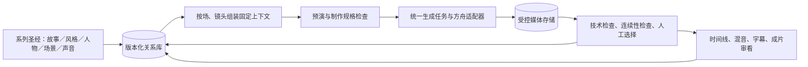

# 60 集以上短剧工作流升级方案：以连续性和少返工为中心

- 日期：2026-10-13；状态：**架构候选，未实施、未批准付费生成**。
- 目标：每集约 **3 分钟**、**60 集以上**，即至少约 180 分钟成片。以 4–6 秒作为镜头长度的**容量测算情景**，约有 1800–2700 个镜头；实际镜头数由剧本、表演与剪辑决定。这个规模要求先解决系列资产、版本关系和制作复用，再解决供应商吞吐。
- 本文取代[先前的 Provider 与素材索引方案](2026-10-13-provider-data-upgrade.md)作为**总体升级方向**；旧文的适配器、任务恢复与媒体转存部分保留为执行模块候选。本文也吸收 [drama-skills 对标计划](2026-10-13-drama-skills-benchmark.md)中模型方言、静帧成片与案例评测的工作包。
- 成功目标是提高**首次候选被接受的比例**、减少跨集返工和重复付费；“一步到位”不能等同于跳过预演、技术校验和真实观看。项目尚未给出题材、目标平台、画幅、预算、素材权属或责任人，本方案不代填这些创作决定。

## 1. 核心判断

**关系型数据库是正确的主干，但数据库本身不能保证一致性。** 它应存储结构化的剧集、剧本、镜头、角色、场景、声音、版本、依赖、任务、选择与审核关系；图片、视频、音频的大文件放项目控制的文件系统或对象存储，数据库存稳定媒体 ID、存储引用、SHA、规格和权利。全文检索先用于找脚本与素材；向量检索可用于探索类似镜头，不能决定哪张图是已批准、哪位角色拿着道具。

新建的系列工作流推荐采用**一个关系库作为结构化制作记录的权威**，包含版本化剧本文本、状态和批准决定；媒体存储是字节权威。当前 VSC 的 `vsc.json` 和批准快照是既有实现的权威，不能在同一项目里再写一套可变的 SQL 状态。实施须先立新的 ADR、定义新 Profile／存储适配器，并以受检快照、事件或只读兼容视图接续现有 CLI；旧作品保持原规则，显式迁移后才能切换权威。数据库迁移不等于取消人工批准和不可变版本。

Provider 抽象仍重要，但它是这一制作链靠后的接缝。第二平台不能修复前期没有固定的场景地理、角色状态和声音表演。

## 2. 从全剧到单镜的版本结构

先建立四层约束，越靠上越稳定，越靠下越具体：

| 层级 | 必须固定的内容 | 允许变化的内容 |
|---|---|---|
| 系列 | 故事与人物弧、视觉风格圣经、画幅／色彩／镜头语法、字幕与混音原则、角色声线身份 | 每集节奏、局部情绪和有意的风格转折 |
| 地点与人物资产 | 角色面貌与体态、地点空间结构／出入口／地标／摄影轴线、道具身份、合法声源 | 服装、伤妆、时间／天气、灯光、摆设、表演状态 |
| 集与场 | 剧本版本、台词行 ID、场景基线、相邻集承接、场景声音空间 | 该场具体站位、动作、情绪、镜头布局 |
| 镜头 | 入点／出点状态、机位和方向、所用资产版本、参考图角色、首尾帧策略、声音 Cue、目标时长 | 候选 take 与后期微调；改变创作规格则建新版本 |

一场戏只存一次基线；各镜保存**状态增量**。例如，角色先站门左侧、右手持杯，镜头 5 把杯放桌上，镜头 6 的入点应自动继承“右手空、杯在桌上”。同一镜头的下一候选必须读取同一固定输入；如果剧本、服装或地点母版升级，下游镜头得到影响报告，已批准旧版本仍可追溯。

## 3. 素材库与数据库最小模型

避免一开始造一张包罗万象的 `assets` 表。按创作身份、媒体字节和执行事实分开：

| 模块／表组 | 最少对象与索引 | 解决的问题 |
|---|---|---|
| 故事与剧本 | `series`、`episode`、`scene`、`shot`、`script_revision`、`dialogue_line`；按集／场／人物／台词 ID 查 | 全剧因果、版本化文本、台词与镜头的明确关系 |
| 系列资产 | `entity`（人物／地点／道具）、`entity_version`、`variant`、`style_version`、`location_view`、`voice_profile`；按身份／状态／用途查 | 同一身份有可控变体，避免“相似图”冒充指定版本 |
| 连续性 | `scene_state`、`shot_state_delta`、`continuity_edge`、`asset_binding`；按相邻镜头和跨集承接查 | 人物站位、服装、手中物、视线、天气、摄影轴线、声场有确定的传递规则 |
| 媒体与血缘 | `media_asset`、`asset_derivation`、`take`、`take_selection`、`render`；按用途、版本、SHA、权利与选用状态查 | 找到“哪张母版 → 哪张改图 → 哪个镜头 → 哪份成片”，也能查出废弃候选 |
| 执行与决定 | `generation_job`、`job_event`、`model_capability`、`budget_ledger`、`approval_decision`；按 run／镜头／状态查 | 远程任务恢复、预算、错误归因、明确人工决定 |

所有关系引用**稳定身份 + 不可变版本**，例如 `scene_id + scene_revision`、`media_id + sha256`；`latest` 只用于界面发现，提交生成前必须解析成确定版本。`asset_derivation` 记录裁切、局部修复、抠像、合成的父素材和变换参数。素材还需记录来源、允许用途、模型／适配器版本、生成请求、实际媒体规格和失效条件。跨项目复用先核权利，再在本项目重新选择，不能继承另一个项目的批准。

### 3.1 AI 如何读素材

AI 不直接扫全库，也不把 60 集剧本、全部图片和所有生成记录塞进上下文。由一个**确定性的上下文组装接口**按 `episode → scene → shot + approved_revision` 查询，返回：

1. 本镜剧情目标、台词行和预计时长；系列风格版本与本场色彩／声音原则。
2. 角色、服装、地点、道具的**身份不变量**及本镜允许变化；相关媒体的用途、版本、SHA、权利状态。
3. 本场基线、本镜入点／出点、前镜出点与后镜预期入点；摄影轴线、屏幕方向、声音桥。
4. 参考素材按角色标记：身份脸、服装、地点母版、机位视图、构图、首帧、尾帧、声音。适配器负责把稳定 VSC 媒体 ID 解析成供应商可用的输入。
5. 完整的输入版本清单与缺项。缺批准、缺参考或状态矛盾时返回错误，不让模型“凭经验补齐”。

这一结果是只读、可哈希的 `ShotContext`／`AssetBundle`，由已批准记录编译；生成请求再由调度模块选模型、加方言和参数。结构化 ID／关系查询是权威；全文或语义搜索只帮人发现可选素材，发现后仍须核定版本和用途。界面至少支持“按人物／地点看资产版本”“按场看连续状态”“按镜看所有候选、用量和选用决定”“按素材看所有下游消费者”。

## 4. 角色、场景、声音的一致性制作

### 4.1 系列视觉与人物

先用少量**有代表性的试镜**固定系列画风：色彩与对比、光源方向、镜头焦段感、构图、人物与背景质感，再定人物规范图、服装状态、表情范围及常驻道具。参考图与文字规格一起冻结；仅固定 prompt 或 seed 不足以保证后续一致。每次生成按角色、状态和本镜用途选择少量相关参考，不把人物所有照片和每个场景都塞给模型。候选经身份、服装、道具、构图检查后才进入下一环节。

### 4.2 场景母版与背景合成

**多次生成背景图是可用的，但用途应是探索、派生和局部修复，而非把几张互不相关的完整背景随意拼接。** 对反复出现的地点，先做场景卡：平面／简易空间布局、门窗与固定地标、摄影轴线、机位图、光源方向、白天／夜晚等状态。批准一张或一组互相兼容的**场景母版**后，再派生正反打、近景、天气或光照变体。高复用、空间复杂的地点可加简单 2.5D／3D 布景或摄影机布局；只出现一次的地点无需承担这套成本。

建议的场景图生产顺序：

1. **定空间**：批准地点布局、人物活动区、机位与地标；用低成本草图／预演检查场景是否可拍。
2. **定母版**：生成几张候选后选择一个基准；固定视角、透视、光源、色彩和可见道具。
3. **派生视图**：从母版做局部编辑、扩图或同布局参考生成；每个视图保留摄像机方向和适用景别。
4. **按需合成**：为复杂画面分别准备背景、前景、道具、人物或光效层，记录遮罩、景深／深度、缩放、透视、遮挡、阴影、调色与来源；合成结果成为新的媒体版本。
5. **检查后转视频**：核对人物比例、接触阴影、边缘、反射、机位与相邻镜头的空间关系；有明显视差或相机移动的镜头，用分层/深度或简易 3D 方案，单张平面图只用于适合的静帧推拉摇移。

方舟[图片生成接口](https://docs.volcengine.com/docs/ark/image-generation-api?lang=zh)当前列有多图参考、交互编辑与部分模型的图层拆分；这些是可试用的**工具能力**，不等于图层自动满足影视合成要求。方舟[视频任务接口](https://docs.volcengine.com/docs/ark/create-video-generation-task-api?lang=zh)区分硬首尾帧与参考图模式，且部分模式互斥；合成好的画面在转视频前要按实际模型和账号验证可接受性。供应商对人脸原始产物的信任规则也不能由对象存储副本自动继承。

### 4.3 声音与表演

每个角色先定有使用权的声源、声线与说话习惯，固定人物到 voice／speaker／资源版本的映射；建立姓名与专有词发音表、语速范围和少量情绪样本。**音色身份**与每句**表演**分开：相同 voice ID 仍可能在低声、喊叫或长句中产生不一致，必须审听。对白保存干声及台词行绑定，再由场景声学链统一处理；环境底、音乐和音效按场景／段落跨镜铺设。视频自带音轨仅作候选，不能默认为全剧固定人声。

当前仓库的豆包语音曾返回认证错误、MediaKit 尚未取得成功线上样本；语音复刻和固定声线不得标为“已跑通”。试点可用已获授权的录音或音轨继续验证剪辑与连续性，不因云 TTS 暂不可用阻断全部工作流设计。

## 5. 把返工前移的制作节拍

以**一镜一个可理解的动作或信息单元**为默认规划单位；相邻镜头有明确边界策略。允许一个镜头多个候选，但首轮不自动每镜生成 2–3 版。高风险镜头先试，普通镜头先生成一版；失败后先定位资产、场景、动作、声音还是模型问题，再决定局部修复、改镜头或再次付费生成。

| 关口 | 当时必须看见什么 | 不通过时退回哪里 |
|---|---|---|
| 系列预制 | 故事／风格／人物／地点／声线规范，重复地点清单，分集弧线 | 剧本或系列圣经，不开始大批量生成 |
| 场景与资产试镜 | 同角色、同地点的远中近景、日夜或服装变体；人物与空间相容 | 角色／地点母版、变体或机位设计 |
| 带声音预演 | 一集约 3 分钟的节奏、信息顺序、台词时长、相邻镜头和跨集承接 | 剧本、ShotPlan、声音 Cue；不靠更贵模型补结构问题 |
| 生成前检查 | 固定的 `ShotContext`、参考媒体、首尾帧策略、模型能力、预算和权利 | 缺项补规格；矛盾先改状态与资产绑定 |
| 候选与剪辑检查 | 媒体真实可解码、身份/空间/动作/声音连续、明确获选 take | 局部修复或创建新候选；保留失败原因与费用 |
| 单集交付 | 时间线、独立音轨、字幕、技术 QA、具名观看审片和交付版本 | 回到最早造成问题的版本，不覆盖已批准快照 |

先完成**一段包含两名角色、一个重复地点和至少两个镜头边界的试验场景**，再完成一整集 3 分钟，接着制作**相邻两集**核对跨集状态和声音桥；只有这几项有真实成片、人审和成本证据后才分批扩到 60 集。可以并行准备后续剧本与母版，但不要在首集未验证前批量付费生成镜头。

衡量“少返工”用：首次候选获选率、每个获选镜头的付费尝试数、返工原因分布、每集连续性错误数、素材复用比例、按集用量与未知账单、生成前缺项拦截数。阈值由真实试点与预算决定，不凭空设一个“零返工”保证。质量关口必须有真实人审；自动检查只能阻断可证明的版本、媒体和状态错误。

## 6. 实施工作包与现有 VSC 的接续

| 次序 | 升级工作包 | 退出证据 |
|---|---|---|
| S0 | 将本方案整理为新的领域模型与 ADR：数据库权威、不可变版本、旧项目接续、项目／媒体存储职责 | 不出现 `vsc.json` 与 SQL 对同一批准状态双写；既有作品能读、历史批准不变 |
| S1 | 关系库与媒体存储最小实现；导入剧本、资产、镜头、决定、旧生成记录；建确定性查询与 `ShotContext` | 可从真实固定版本组装一镜输入，改上游版本能定位下游影响；素材字节与 SHA 可恢复 |
| S2 | 系列圣经、场景母版／视图、声音身份与发音表的版本契约和预演入口 | 同一人物与地点跨镜试样有来源、有检查和人工选定；不是只传一段风格提示词 |
| S3 | 在[旧 Provider 子方案](2026-10-13-provider-data-upgrade.md)基础上接方舟图像、视频任务，声音按真实权限逐类接入；统一 job、预算、候选与选用关系 | 未知提交不重发；产物可按镜、场、集查询；临时 URL 已转存；未认证音频不冒充成功 |
| S4 | 按 [G01–G04](2026-10-13-drama-skills-benchmark.md)做模型方言试验与静帧成片；完成场景、整集、相邻两集试点 | 可打开的成片、选用 SHA、真实声音／技术 QA、观看结论、返工根因与实际成本 |
| S5 | 根据试点建立分批生产上限、并发与复用策略，逐批扩至 60 集以上；保留 G05 的真实回放证据 | 可以暂停、恢复、按集对账和局部返工；跨集风格、空间、声音按版本复核 |

工作流内核、角色、Profile、批准 Gate、selected-takes、预算与交付链仍要接续 [production-v2](../../workflow/production-v2.md)；不得用新数据库绕过人工决定。实施 S0–S3 属于行为／契约／schema 变更，需按 [VSC 架构维护](../../skills/vsc-architecture/SKILL.md)写迁移、测试、版本和 release notes，并在完整本地 CI 通过后提交。真实试点、付费调用、声源使用和公开案例另需对应项目授权。
