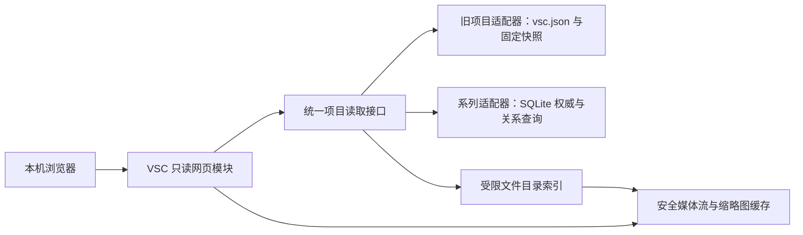

# VSC 内置项目浏览器方案

状态：**候选方案，尚未实现**。本方案提供 VSC 自带的只读网页功能；它不是 Skill、角色、制作阶段或新 Profile，也不改变作品的批准与生成流程。

## 目标与当前依据

使用者打开一个本机网页，就能从项目卡片进入文案、集／场／镜头、人物与场景资产、图片／视频／音频、产物版本和交付候选。查看一份素材时能看见它属于哪里、来自哪个版本、是否已批准，以及还有哪些待审问题，无须逐层翻目录。

当前两个本机样本均使用 `vsc.json` 作为状态权威，分别有 17 和 37 份登记产物；其中一部没有集／场／镜头对象，另一部已有 1 集、7 场、43 镜头。两部作品都有大量媒体文件未作为关系库媒体登记。现有 `vsc.series-db` Profile 则以项目 SQLite 为权威，已有对象、产物、台词行、媒体、派生和用途绑定索引；目前还没有网页浏览器。首版必须同时适配旧 JSON 项目与新的系列数据库项目，也必须让未登记文件可见并明确标注状态。

## 产品形态

入口拟为 `python3 -B scripts/vsc_view.py serve --root projects`，默认只绑定 `127.0.0.1`，启动后输出本机 URL。浏览器由 VSC 仓库直接提供，不要求宿主 AI 客户端或第三方 Skill 才能打开。`pyproject.toml` 记录运行此功能实际需要的依赖；若可用标准库完成首版，就不引入前端构建工具。网页只读，修改文案、素材绑定、批准和生成任务仍走现有 VSC CLI。

| 页面 | 首版显示内容 | 必须保留的事实 |
|---|---|---|
| 项目总览 | 项目卡片、封面占位、Profile、当前阶段、更新时间、文案／素材／成片数量 | 只发现 `projects/` 下有效项目；没有封面时不虚构“已选封面” |
| 项目主页 | 阶段进度、Gate 阻塞项、最近产物、待审候选与交付版本 | “已有批准记录”和“当前 Gate 有效”分开显示 |
| 文案 | 委托、来源摘要、改编、分集、剧本、对白与字幕；按集／场／版本切换 | 默认显示当前有效版本；草稿、驳回、过期和历史版本显式可切换 |
| 素材 | 图片网格、视频播放器、音频播放器、文档预览；按模态、角色、场景、镜头、用途、状态筛选 | 已登记媒体可追溯 ID、SHA、权属与绑定；未登记文件只显示路径和“待归档”，不猜测关系 |
| 制作关系 | 集 → 场 → sequence → 镜头；镜头所用资产、候选 take、声音与交付片段 | 有对象树的项目显示关系；无对象树的旧项目仍能按阶段和文件浏览 |
| 文件清单 | 工作目录中的文档及媒体，标记已登记／未登记／重复／丢失 | 原始目录保留；文件清单是发现视图，不是新的项目状态权威 |

首版文案预览覆盖现有 JSON 契约中的剧本／场次／对白、Markdown、纯文本和 SRT；未知 JSON 用安全的结构化树展示。图片直接预览，视频支持拖动播放，音频可播放并显示时长。来源 EPUB 等需要专门解析的格式先显示元数据和文件位置，不把“文件存在”写成“正文已解析”。

## 读取架构与数据边界

统一读取接口只返回展示模型，例如 `ProjectSummary`、`ArtifactVersion`、`CreativeObject`、`MediaItem` 与 `FileEntry`。旧项目从 `vsc_state` 的只读状态读取产物、对象、批准及依赖；系列项目以 SQLite 只读连接读取权威数据，并复用或抽取 `vsc_series_query.py` 的关系查询逻辑。网页不直接把 `vsc.json` 镜像当系列项目权威，不在浏览器里重建 Gate 判断，也不在作品旁边建立第二套可写状态。

文件目录索引补足旧项目未登记的素材：只扫描配置的项目根目录，合并已登记 SHA／路径后标记“待归档”；目录名只能用于导航，不能推断人物、镜头、权属或批准。排除数据库文件、锁、暂存、密钥、生成原始响应和可再生构建缓存。缩略图及搜索索引只是可删除的派生缓存；项目 revision、文件大小与修改时间变化时增量刷新，打开详情或用于正式用途时再按既有 SHA 规则核验。对 60 集项目使用分页和按需缩略图，不能每次打开首页都解码全库媒体。

网页接口建议保持少量只读查询：项目列表／详情，按阶段和范围分页的产物列表，按集／场／镜头的关系详情，媒体与文件列表，文本搜索，以及按不透明 ID 读取预览流。视频流须支持 Range 请求；所有媒体请求只能解析到当前项目允许的文件，拒绝 `..`、符号链接逃逸和任意绝对路径。用户提交的 Markdown／HTML 以安全文本或经过净化的格式渲染，不执行嵌入脚本。默认本机访问、无跨域开放；局域网或外网访问需要另做身份认证与部署设计，不能只把监听地址改为 `0.0.0.0`。

浏览配置只控制端口、可扫描目录、排除规则、缩略图尺寸和页面偏好；不保存项目的批准、权属、人物身份或镜头关系。界面上所有“生成”“批准”“删除”“改写”操作在首版均不提供，避免绕过现有 CLI 与质量门。

## 实施顺序与验收

| 工作包 | 可交付结果 | 验收重点 |
|---|---|---|
| V1 读取模块 | 两种项目适配器、统一展示模型、受限文件目录索引 | 同一项目状态与 CLI 一致；镜像失配、快照缺失和未登记文件如实显示 |
| V2 本机网页 | 项目首页、文案页、媒体网格与详情、版本状态、视频／音频预览 | 两种现有项目可直接打开；无需迁移、生成或手工逐项编索引 |
| V3 关系与检索 | 集／场／镜头导航、资产派生和用途绑定、跨项目文本与文件名检索 | 系列数据库关系可点击回溯；旧项目没有关系时不造假；60 集分页可用 |
| V4 交付审查 | 候选成片、字幕和 QA／审片记录并排查看 | “可播放”“技术检查通过”“人工批准”是三个独立状态 |

公开测试用合成项目验证 JSON 与 SQLite 两种权威、版本替代、缺失文件、路径逃逸、HTML 注入和媒体 Range；本机验收用现有两部作品实际打开网页，逐一核对文案、图片、视频、音频、状态和未登记文件。测试不得把作品正文、截图或素材提交到 Git。全量 CI 只在最终提交／推送阶段运行。

## 待定决策

默认按**仅本机浏览**设计。若使用者需要手机同网段或外网访问，应先确定访问范围、认证方式和是否允许展示未获授权的来源内容，再扩展服务配置。首版不以这项决定阻塞本机阅读能力。
