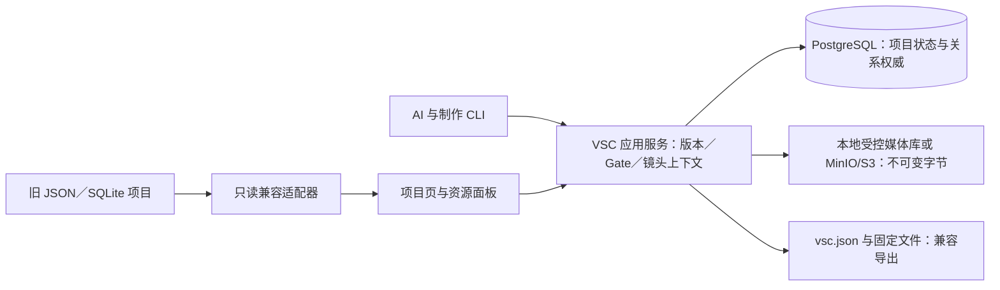

# VSC 内置项目资源面板与 PostgreSQL 关系库升级方案

状态：**候选方案，尚未实现**。本方案升级[项目浏览器方案](2026-10-14-project-browser.md)：浏览能力保留，增加 PostgreSQL 资源关系权威和可审计的素材管理。它是 VSC 工作流自带的界面与存储能力，**不是 Skill、角色、制作阶段或供应商插件**。本文不代表现有项目已迁移，也不代表网页、PostgreSQL 或在线生成已经跑通。

## 目标、基线与决定

面向每集约 3 分钟、60 集以上的连续短剧，使用者应在项目页按“集 → 场 → 镜头”同时看到剧本、台词、角色／场景母版、候选与获选图像、视频、声音、字幕、版本和审核记录；点开一张图应能追到来源、组成图层、用于哪些镜头、是否仍有效。AI 则通过同一查询服务取得**已批准且仍有效**的镜头上下文，避免在目录里猜文件名或把草稿当制作依据。关系清晰有助于提前发现错用素材、风格漂移和跨镜不连贯；它不能保证一次生成就达到审美要求，最终仍需样片回看与人工选片。

当前事实：已采纳的 [ADR 0004](../adr/0004-series-relational-authority.md)规定 `vsc.series-db` 以项目 SQLite 为唯一写入权威，`vsc.json` 是派生镜像；旧 Profile 仍以 `vsc.json` 为权威。两部现有样本“放下”和“gudu-de-qiu”属于旧 JSON 项目，媒体文件多于已登记关系。现有系列库已有 `creative_objects`、产物版本、媒体、派生、用途绑定、人工决定和生成任务；[项目浏览器方案](2026-10-14-project-browser.md)尚未实施。**不能让同一项目的 SQLite 和 PostgreSQL 同时负责写入素材绑定或批准状态。**

建议决定：增加显式的 PostgreSQL 系列存储策略（拟名 `postgres-series-v1`，对应新建 Profile 可拟名 `vsc.series-pg`），供**新建或经核验迁移**的项目使用。对该策略，PostgreSQL 在一个事务边界内管理项目状态、剧本／产物固定版本、对象、媒体关系、批准和任务记录；`vsc.json` 只作兼容导出镜像，原始文件和媒体字节保留在受控本地目录或对象存储。旧 JSON／SQLite 项目继续原权威，资源面板先兼容只读浏览，逐项目迁移后才开放关系编辑。迁移只能改变经核对的存储实现，不能顺手改写原项目的阶段、Gate、批准或 Profile 快照；旧 Profile 若无法无损映射为系列关系，保持只读兼容，另做经负责人确认的业务迁移。实施前须新增取代或补充 ADR 0004 的架构决定，明确 Profile、镜像、迁移和回退规则；本提案本身不修改已采纳规则。

## 用户界面：项目页内的资源面板

保留项目总览、文案和媒体浏览；在每个项目页内嵌资源面板，而非另建一套素材应用。默认本机 `127.0.0.1` 访问。

| 区域 | 要呈现的事实 | 典型操作 |
|---|---|---|
| 项目／集／场／镜头树 | Profile、阶段、版本、Gate 与镜头状态 | 切换范围，定位缺素材镜头 |
| 剧本与时间线 | 已批准正文、台词行、字幕、镜头规格及历史版本 | 与素材并排核对，不直接改批准快照 |
| 资源面板 | 角色身份／服饰、地点母版／视角、道具、关键帧、视频 take、干声、环境声、成片；候选／获选／失效分明 | 按人物、场景、镜头、用途、状态、来源过滤，预览播放 |
| 资源详情 | SHA、稳定 URI、权属、分辨率／时长、父素材与合成配方、生成任务、被哪些镜头引用、决定记录 | 追溯派生和影响范围，比较候选 |
| 待归档清单 | 项目目录中尚无关系登记的文件、丢失文件、摘要不符文件 | 发起登记草稿；不能凭文件名自动批准或绑定 |

首阶段只读浏览。后续可在 PostgreSQL 项目中提供“登记候选、填写来源和权属、建立派生、提交用途绑定、人工批准／退役”等操作；网页与 CLI **共用同一个应用服务和事务／审计规则**，浏览器不直连数据库，不自行计算 Gate，也不替负责人批准。旧项目在迁移前仍按原权威读取，界面明确标“只读／待迁移”。

## 数据与写入边界

PostgreSQL 存**标识、状态、版本、关系和索引**；视频／音频／大图字节在媒体库，库内存稳定 `local_uri`／对象键、SHA-256、探测信息。供应商临时 URL 只在受限任务记录中留审计痕迹，不作播放或复现地址；外部 `task_id` 只属于生成任务。素材入库先写临时对象并校验摘要，再事务登记媒体和关系；DB 提交失败可清理孤儿字节，媒体读取失败或摘要变化则标“不可用”并阻断正式选择。数据库备份与媒体字节备份必须配套，恢复后抽样按 SHA 核对。

CLI、网页和镜头上下文编译器依赖统一的**项目存储／关系查询接口**；PostgreSQL 是该接口的新适配器，旧 JSON／SQLite 适配器在各自项目上继续按原权威读取或写入。生成调度仍依赖现有图／视频／音频 Provider 接口；迁移关系库不改变 `AssetBundle` 逻辑规格，不把火山方舟参数写进业务表。写入接口同时负责项目修订冲突、版本固定和审计，避免网页另起一套保存逻辑。

**建议的核心表与关系**（名称为目标契约，具体字段在实施 ADR 和迁移中固定）：

| 表 | 关键字段／关联 | 权威含义 |
|---|---|---|
| `projects`, `project_state` | `project_id`, `profile_snapshot`, `revision` | 项目与修订，保持既有 Gate 语义 |
| `creative_objects` | `project_id`, `id`, `kind`, `parent_id`, `scope` | 集、场、镜头、人物、地点、道具的稳定身份及层级 |
| `artifact_versions`, `artifact_dependencies`, `approval_decisions`, `script_lines` | `project_id`, 固定版本 ID、摘要、状态、文本／JSONB 快照、批准者与依赖 | 剧本、台词和制作规格可按版本追溯；批准记录不因界面展示而改变 |
| `media_assets` | `project_id`, `id`, `modality`, `sha256`, `local_uri`, `rights`, `origin`, 探测／可用性 | 单个媒体版本的身份；URL 与文件名不是身份 |
| `asset_derivations` | `project_id`, `child_id`, `parent_id`, `relation`, `layer_order`, `recipe` | 参考、裁切、修复、抠像和多图合成的来源链 |
| `media_bindings`, `media_binding_decisions` | `project_id`, `target_id`, `role`, `variant`, `media_id`, `status`, 人工决定 | 某人物／地点／镜头的特定用途选择；候选和批准分离 |
| `continuity_edges` | `project_id`, 相邻镜头、出入状态摘要、策略和版本 | 跨镜空间、动作、光线和声音衔接证据 |
| `generation_jobs`, `job_events`, `generated_assets` | `project_id`, 固定请求、Provider／模型、外部任务 ID、状态、费用和输出媒体 ID | 调度与追责；供应商细节不进入镜头业务表 |

每张项目表带 `project_id`；项目内实体以 `(project_id, id)` 作为唯一键，关系表用**包含 `project_id` 的复合外键**，防止误连另一作品的同名 ID。绑定目标要真实引用 `creative_objects`，脚本行用途变体另按已批准台词行验证，不保留无外键的任意字符串关系。已批准的 `(project_id, target_id, role, variant)` 只允许一条有效绑定；用部分唯一索引实现，同时保留历史候选和退役记录。PostgreSQL 对复合外键与部分唯一索引的支持见[约束文档](https://www.postgresql.org/docs/current/ddl-constraints.html)与[索引文档](https://www.postgresql.org/docs/current/indexes-partial.html)。派生边在应用层再检查环、跨项目引用和图层次序；关系库约束并不自动解决这些业务规则。

核心关联列采用结构化列与普通索引：`project_id + kind/parent_id`、`project_id + target_id/role/status`、`project_id + parent_id`、`project_id + scope/status`、`project_id + sha256`。JSONB 只放模型差异、探测扩展或合成参数，**不把镜头、人物、绑定藏进 JSONB**。查询热路径实测后再为 JSONB 条件加 GIN；中文正文检索作为独立可替换的发现索引评估，命中候选后仍回到版本、批准和绑定查询。PostgreSQL [GIN 文档](https://www.postgresql.org/docs/current/gin.html)支持这类索引选择，但是否值得启用以真实查询计划为准。跨项目复用须有单独的库资产身份与显式“借用／复制”记录，不能直接让 A 项目的绑定指向 B 项目的私有媒体，也不能继承 B 的批准。

## AI 读取与减少返工的生产链

资源面板和 AI 调用同一查询服务。面板可显示草稿、驳回和失效版本；正式 `ShotContext`／`AssetBundle` 只由当前 Gate 有效的批准版本与批准绑定确定性编译，附带项目修订、版本 ID、媒体 SHA 和缺口清单。API 至少提供项目／对象导航、版本与媒体分页、媒体派生和被引用位置、镜头上下文、差异比较以及预览流；AI 不直接读全表、执行任意 SQL 或凭向量相似度决定正式素材。图片、音频、视频预览按不透明 ID 取流，限制根目录、拒绝路径逃逸，视频支持 Range；默认只供本机访问。

| 制作节点 | 先查询／冻结什么 | 防返工检查 |
|---|---|---|
| 编剧与分镜 | 已批准剧情、人物状态、场景、台词行和前后镜头连续性 | 台词与镜头覆盖、时间／空间矛盾 |
| 图像 | 角色身份母版、服饰版本、场景母版、镜位与风格规则 | 参考图权属和可用性、构图／光向一致；候选经人选后冻结 |
| 视频 | 已选关键帧、入出点状态、目标动作和镜头长度 | 不把视频模型输出自动替换为角色或场景母版 |
| 音频 | 角色已批准音色／语音版本、逐字台词、声场和环境声 | 同角色音色与后处理链、说话人、读法与时长人工审听 |
| 合成与交付 | 已选 take、字幕、音频桥、时间线与固定 SHA | 技术 QA、跨镜回看和负责人最终批准分别留痕 |

对需要多次生成的背景图，建议先建立**场景母版**（布局、机位轴线、透视、光线、时间段和色彩），再为不同镜位／时段做版本。确需拼合时，分别登记背景、前景、角色、道具、遮罩等源图和各自权属；把裁切、缩放、透视、图层顺序、调色和遮挡写成可复现配方，输出一张新的不可变媒体版本，用 `asset_derivations` 连回所有输入。合成结果经过透视、阴影、接触边缘和跨镜一致性审查后再绑定镜头。多次生成再合成**适用于分层可控的场景**，不是每张背景都必须拼接；无限叠图会增加光影和比例冲突。界面应同时预览合成图与来源图层，避免只剩一张无法修改的扁平图。

## 兼容与迁移路线

| 顺序 | 交付物 | 完成条件 |
|---|---|---|
| P0 决策 | 后继 ADR、PostgreSQL 存储策略／Profile、旧权威映射和回退规则 | 明确同一项目只写一个权威；当前 SQLite Profile 不被静默改义 |
| P1 存储 | PostgreSQL schema 迁移、事务仓储、媒体转存接口、项目修订与镜像导出 | 合成项目能登记版本、关系、决定和任务；跨项目错连、重复批准被约束拦下 |
| P2 只读面板 | JSON／SQLite／PostgreSQL 读取适配器、文件待归档清单、项目／文案／资源／镜头页 | “放下”和“gudu-de-qiu”可浏览真实内容；未登记素材不冒充已有关系 |
| P3 显式迁移 | `preview → backup → import → compare → cutover` 工具，逐项目执行 | 核对对象／版本／批准／绑定／任务数、固定字节与媒体 SHA；切换后旧权威只读，失败可回到备份，不双写 |
| P4 关系管理 | 面板与 CLI 共用登记、派生、绑定、人工决定接口 | 审计、冲突、权属与 Gate 结果一致；无网页快捷批准 |
| P5 制作验证 | 1–2 集真实素材的图 → 视频 → 音频 → 合成与跨镜回看，再扩 60 集 | 追踪返工原因、错绑率、镜头上下文缺口、声音／风格一致性及人工审片结果 |

迁移预览必须报告无法解析的旧文件、缺失 SHA、孤立引用、未知权属和状态冲突；这些内容只进待归档或待人工决定清单，不自动变成批准素材。旧项目若尚无集／场／镜头对象，面板展示已有文案和文件，但不补造镜头关系。迁移期间冻结该项目写入，完成全量对比后以一次明确的存储策略切换恢复写入；回退恢复 PostgreSQL 前的原权威快照和媒体引用，已在新库写出的决定不可静默丢弃。数据库连接通过进程环境（例如 `VSC_DATABASE_URL`）配置，密钥仍按[工作区设置](../guide/workspace-setup.md)放在本机环境，不进入仓库、作品文件或网页响应。

实施时以 60 集分页、范围查询和素材反向引用为性能验收对象；只有慢查询证据后才考虑分区、全文扩展或向量索引。`pyproject.toml` 记录实际新增的 PostgreSQL 驱动与 Web 依赖，避免文档声称的功能依赖隐式装在个人环境里。

## 验收与边界

- 用户打开项目页能看到“放下”和“gudu-de-qiu”的现有文案及图片／视频／音频，清楚区分已登记、待归档、缺失和未获批准；两者在迁移前保持旧状态权威。
- 新建或已迁移的 PostgreSQL 项目，点开一个镜头可追到剧本固定版本、场景母版、角色参考、关键帧、take、台词干声、生成任务与人工选择；反向查找“此素材影响哪些镜头”一致。
- 同一批准用途不会并存两条当前绑定；跨作品误连、无权属或摘要失效素材不能进入正式生成上下文。并发写入遇项目 revision 变化须提示冲突，不悄悄覆盖。
- 合成背景图的每个输入、配方和最终 SHA 可追溯；覆盖／替换资产后能列出受影响镜头。素材关系帮助减少返工，但不能把结构检查误报为风格、语音或成片质量已通过。
- 测试先限受影响模块与合成项目；提交前按工作区规则跑完整本地 CI。本提案阶段不调用火山方舟、不迁移私人作品、不提交作品素材。
