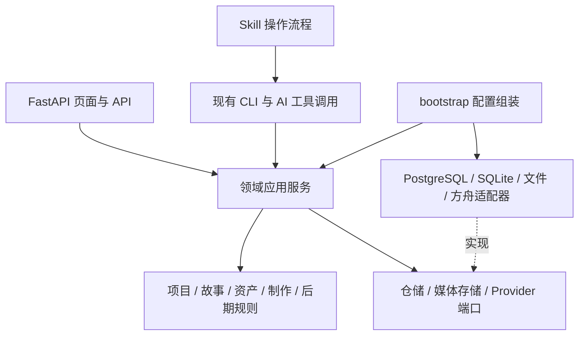
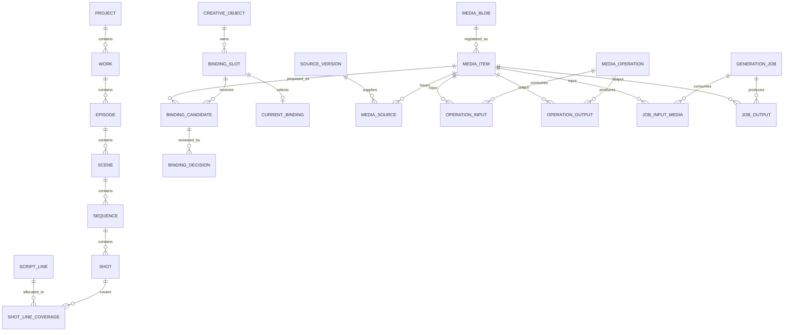

# VSC 工程结构、PostgreSQL 资源关系与内置审查面板升级方案

日期：2026-10-15。状态：**工程改造已实现；线上制作待用户脚本验证**。本文是 [10 月 14 日 PostgreSQL 资源面板方案](2026-10-14-project-resource-panel-postgresql.md)的第二版，吸收后续关于工程目录、FastAPI、关系建模、SSOT、素材审查和建表 SOP 的要求；同时沿用 [10 月 13 日 drama-skills 对标](2026-10-13-drama-skills-benchmark.md)的证据边界。下文基线与设计讨论保留实施前语境；实际入口见[资源面板指南](../guide/resource-panel.md)和 [v0.21.0 实施记录](../releases/v0.21.0.md)，线上制作由用户后续提供脚本验证。

### 实施记录（v0.21.0）

| 阶段 | 已落地内容与证据 |
| --- | --- |
| P0 | ADR-0005 固定多部层级、单一权威和显式切换；表字典／ERD 可由规范 metadata 生成 |
| P1 | 52 个原脚本迁入领域包和维护工具，保留兼容入口；打包、锁文件、Python 3.9 与影响选择已验证 |
| P2 | 59 张关系表、159 条冻结迁移 DDL、schema 审查 SOP／检查器；真实 PostgreSQL 21 项专项通过 |
| P3 | FastAPI 内建资源面板、旧 JSON／SQLite 只读、PostgreSQL 读取、层级／文案／媒体／来源用途展示 |
| P4 | 受控上传、来源／权利、人审选择、拒绝／退役／停用分离；显式迁移与故障恢复经合成项目验证，未自动切换既有作品 |
| P5 | 首个资产参考起步、图／视频／音频固定任务、未知提交恢复、预算和固定时间线到 Remotion 工程准备已离线验证；用户真实脚本试点、线上调用和成片审阅待执行 |

媒体转换覆盖缩略图、海报、波形、代理视频和 PDF 首页。网页已有 HTTP 与真实 PostgreSQL 操作证据；当前宿主未授予浏览器视觉检查权限，实际界面视觉验收仍需使用者查看。S3/MinIO 适配器已有本地协议测试，真实对象存储部署未作为本次验证证据。

## 1. 目标与本次升级范围

目标是支撑 **60 集以上、每集约 3 分钟**的连续制作。使用者在 VSC 项目页内浏览文案与媒体，沿项目、部、集、场、镜头查看来源、用途、选择和下游影响；AI 经统一接口获取当前镜头所需的固定版本。把不一致、漏台词、错用图、音色漂移和失效依赖尽量提前发现，减少整集重做。

关系型数据库适合管理这些事实。建议采用 PostgreSQL 管理结构、文本版本、关联与决定，受控本地媒体库或 MinIO/S3 管理大文件字节。全文或向量索引只帮助找候选，命中后仍须核对关系、版本和决定。数据库能保证引用与状态规则，画面、表演和声音是否合适仍需真实样片与人工审阅；“一次准备充分、局部返工可控”作为工程目标，不承诺一次生成必然达到交付质量。

| 10 月 14 日方案 | 本版具体升级 |
|---|---|
| 增加关系库和资源页面 | 先拆分业务模块，网页、CLI、AI 共用应用服务 |
| 核心表概览 | 明确每行含义、实体与关联表、基数、约束和版本权威 |
| 媒体与派生边 | 分开物理字节、素材登记、来源、加工操作、输入／输出与预览副本 |
| 绑定中保存用途和批准状态 | 分开用途槽位、候选、审查、决定、当前选择与历史固定引用 |
| 项目／集／场／镜导航 | 补充“部”的候选语义，保留现有镜组 `sequence`，覆盖文案、台词与剪辑 |
| 通用 Web 接口 | 明确 FastAPI 目录、事务、分页、预览、冲突和操作归属 |
| 工程规则散在说明中 | 设计未来 `vsc-schema-review` 建表审查 Skill 及其执行检查器 |

资源面板是 **VSC 内置产品功能**。Skill 负责操作和维护 SOP，Python 包负责功能实现，数据库迁移负责结构演进，前端负责展示与发出操作请求。

## 2. 当前实现基线与兼容边界

本版核查基线为 `4615071`，插件版本 `0.19.0`。`scripts/` 有 52 个 Python 文件、约 1.83 万行代码，以及维护 Shell 入口；尚无本方案所述的 `src/vsc/`、PostgreSQL 迁移目录和 FastAPI 应用。`pyproject.toml` 已被跟踪，声明 Python `>=3.9`、空依赖及项目版本 `0.18.2`，与插件版本有差异，实施打包时须明确版本来源。

已有能力包括产物固定版本、人工批准、SQLite 系列关系库、用途绑定、镜头上下文、统一 Provider、可恢复生成任务、媒体转存及选片检查。v0.19.0 已区分逐镜地点、在场实体、入画实体和画外声音；重构须保留这些语义。当前关系库中的部分对象引用未有外键、合成关系无法表达同一源图的多个独立图层、部分素材反向查询仍须扫描生成请求；这些是本版要消除的结构性缺口。

10 月 13 日对标中的方法吸收落在既有契约和版本绑定的试用／评测记录中：场景锚点、构图和声音方法可作为规格依据，供应商差异由适配器处理。面板呈现这些来源与试用证据，并区分“已实现、离线验证、真实制作验证”；静帧成片和生成视频分别验收。上游 `v0.8.1` 仅作为该次固定研究快照，采用其方法不赋予其执行器或看板新的项目状态权威。

遵守已采纳的 [ADR 0004](../adr/0004-series-relational-authority.md)：

- 旧 JSON Profile 继续以 `vsc.json` 为权威；`vsc.series-db` 继续以 SQLite 为权威。面板先提供读取适配器，不改旧项目的 Profile、Gate 或批准记录。
- 拟新增 `postgres-series-v1` 存储策略；新建系列 Profile 可命名为 `vsc.series-pg`。实施前提交后继 ADR，分别定义业务 Profile 和存储策略，不以改一个 Profile 名称代替数据迁移。
- 一个项目在任何时刻只有一个可写状态权威。PostgreSQL 项目的 JSON／文件导出是可重建镜像，不接受反向编辑同步。连接失败不自动切回 SQLite 或 JSON 写入。
- 现有 CLI 路径、参数、退出码及契约保持兼容。旧项目缺少结构关系时显示“未建立关系”，不根据文件名自动补造镜头或批准。
- Provider 能力、在线接口验证和项目创作质量分别报告；本轮方案不调用火山方舟，后续真实测试由用户提供脚本后安排。

## 3. 工程结构与职责

### 3.1 目标目录

以下是拟建结构，不是当前可运行入口。按领域组织，模块内部再分领域规则、应用用例和端口；只在实际存在这些职责时创建对应文件。

```text
src/vsc/
  kernel/                    # 读取 workflow 声明、契约校验、宿主与派生视图
  project/                   # 项目状态、产物版本、依赖、批准、影响分析
  story/                     # 剧本、台词覆盖、状态时间线、集场镜连续性
  assets/                    # 资产身份、素材、来源、加工、绑定、审查、跨作品复用
  production/                # 固定运行、任务、预算、调度、选片一致性
  post/                      # 时间线、字幕、混音规格、渲染计划、交付
  knowledge/                 # 方法、规格包、检索、试用记录
  adapters/
    persistence/             # legacy_json/、sqlite/、postgres/；仓储和事务实现
    storage/                 # local/、s3/；字节、摘要、稳定 URI
    providers/               # volc_ark/、speech/；供应商通信与响应解析
    media/                   # ffprobe、FFmpeg、预览转换、临时声音等工具适配
    editors/                 # Remotion、剪映草稿输出
  interfaces/
    cli/                     # 参数解析、应用服务调用、终端输出
    web/                     # FastAPI app、routers、请求/响应 schemas、presenters
      templates/             # 首版页面模板
      static/                # 按页面职责划分的 CSS 与 JavaScript
  bootstrap.py               # 配置及依赖组装，不承载业务规则
migrations/postgres/         # 唯一数据库迁移历史
scripts/                     # 保留原命令路径的薄入口和必要兼容导出
tools/maintenance/           # CI、Git 钩子支持、Vendor 生命周期实现
tests/                       # 按领域、适配器、接口组织；保留旧入口回归
workflow/                    # 阶段、角色、契约等规范的原始来源
skills/                      # SOP；含未来建表审查技能
docs/architecture/           # 模块说明、数据字典、查询与权威说明
```

`scripts/` 最终只处理启动、兼容和委派，不再新增 SQL、媒体编排或 HTTP 业务。兼容导出必须转发到唯一实现，不能复制函数。首次拆包优先提取内部模块，保留旧命令启动方式；统一安装／包发现方案验证完成后再逐步精简入口，避免要求每个脚本自行修改 `sys.path`。

### 3.2 现有文件的责任归属

下表覆盖当前 52 个 Python 文件和维护 Shell 入口。跨职责文件按函数和业务边界拆分，并保留原入口测试；不按文件名整体搬进一个新的大模块。

| 当前入口／文件 | 目标归属 |
|---|---|
| `vsc_kernel.py`, `vsc_hosts.py`, `vsc_views.py` | `kernel`；生成宿主入口仍从 `workflow/` 读取 |
| `vsc_state.py`, `vsc_artifacts.py`, `vsc_impact.py` | `project`；参数和输出移到 `interfaces/cli` |
| `vsc_sources.py` | `assets` 的来源登记；`project` 通过公开端口使用来源版本 |
| `vsc_story.py`, `vsc_sequence.py`, `vsc_performance.py` | `story`；对白、表演与镜头覆盖规则 |
| `consistency.py` | 资产身份校验归 `assets`；场景状态、逐镜锚点与连续性归 `story` |
| `vsc_series.py` | 导入与绑定归 `assets`；ShotContext 编译归 `production`，调用 `story` 的状态推导 |
| `vsc_series_db.py` | `adapters/persistence/sqlite`；业务用例依赖仓储端口 |
| `vsc_series_query.py` | 查询语义归相应领域应用服务；SQL 归仓储；CLI 归接口层 |
| `vsc_provider.py` | `production` 中图／视频／音频逻辑接口与数据契约 |
| `vsc_series_jobs.py`, `vsc_series_dispatch.py`, `vsc_series_run.py`, `vsc_series_export.py`, `vsc_series_selection.py` | `production` 的任务、执行、固定运行、导出与选片一致性 |
| `vsc_run.py`, `vsc_production.py`, `vsc_audio_run.py`, `vsc_budget.py`, `vsc_handoffs.py` | `production`；供应商专用通信再下沉到 Provider 适配器 |
| `volc_ark.py`, `vsc_volc_provider.py`, `doubao_speech.py`, `doubao_audio.py` | `adapters/providers`；业务只使用统一端口 |
| `vsc_credentials.py`, `vsc_toolchain.py` | 适配器配置／就绪诊断；环境变量名与凭证读取约定只有一处实现 |
| `vsc_library.py` | `assets` 的跨作品复用；不把来源作品批准复制为新项目批准 |
| `vsc_craft.py`, `vsc_recipes.py`, `vsc_learning.py`, `vsc_search.py` | `knowledge`；检索结果仍需回查版本与业务绑定 |
| `remotion_plan.py`, `jianying_export.py`, `jianying_draft.py` | 时间线规格校验归 `post`，软件专用转换归 `adapters/editors`；保留第三方署名 |
| `subtitles.py`, `subtitle_burn.py`, `media_qa.py`, `vsc_delivery.py` | `post` 规则与应用用例；探测／转码／烧录命令归 `adapters/media` |
| `temp_voice.py`, `procedural_audio.py` | `adapters/media`；产出仍登记为候选或预演素材 |
| `vendor_bundle.py`, `vendor_review.py`, `vendor_skills.py`, `vendor_sync.py`, `vendor_watch.py`, `vsc-vendor-maintenance.sh` | `tools/maintenance/vendor`；运行时发现接口需有明确可导入边界，不能反向依赖维护 CLI |
| `vsc_local_ci.py`, `vsc_pre_commit.py` | `tools/maintenance`；现有钩子路径保留兼容入口 |

### 3.3 依赖方向与公共接口



公开用例拟包括 `get_project_tree`、`list_resources`、`get_artifact_version`、`get_media_lineage`、`get_media_usage`、`compile_shot_context`、`register_media`、`propose_binding`、`record_review`、`select_candidate`、`retire_binding`。每个用例声明输入版本、权限、事务范围、输出与错误；HTTP 路由和 CLI 都调用它们。

领域规则不导入 FastAPI、SQLAlchemy、供应商 SDK 或兼容脚本。跨模块通过明确接口调用，不共享一个万能 `utils.py` 或到处传数据库连接。项目 revision、用途槽位选择和任务状态等写入由应用服务统一提交；读服务可以批量查询，避免每张素材卡逐个请求关系。

`pyproject.toml` 在实施时声明包发现、构建方式、CLI 入口及实际依赖，建议分为核心、`web`、`postgres`、对象存储和开发测试依赖组；核心 CLI 不因未装 Web 依赖而无法启动。FastAPI、数据库驱动、SQLAlchemy Core、Alembic 是当前建议组合，具体版本与 Python 最低版本在 P1/P2 用可复现安装验证后固定。明确锁文件和版本同步策略，消除包版本与插件版本的无说明分歧。

## 4. 数据建模原则：事实原子化与 SSOT

先定义“每一行表示什么”，再定义主键、基数和状态。基本范式要求：不把多个可独立关联的值塞进一个字段或重复列；非键属性依赖完整候选键；可独立变化的间接事实归其所属实体。VSC 据此以第三范式为默认设计目标，快照和性能投影作为明确记录的例外。基础背景见 [Microsoft 的规范化说明](https://learn.microsoft.com/en-us/previous-versions/troubleshoot/microsoft-365/microsoft-365-apps/access/database-normalization-description)。

| 规则 | 本项目的具体约定 |
|---|---|
| 一事实一权威 | 当前用途选择、素材权属、版本内容分别有唯一归属；不同时在素材行、镜头 JSON 和前端缓存维护可编辑副本 |
| 实体保存自身属性 | 媒体字节记录 SHA、大小、格式；镜头记录身份与层级。镜头使用哪些图片由用途关联表达 |
| 固定 1:N 用外键 | 集属于部、场属于集、镜组属于场、镜属于镜组；无独立关系属性时无需额外中间表 |
| M:N 或带状态的关系独立建表 | 镜头与台词覆盖、素材与来源、用途候选、加工输入、任务输入、时间线用料等各自建表 |
| 关系类型可约束 | 不用万能 `from_id / relation / to_id` 表承担全部业务，不用无真实外键的 `target_type + target_id` 字符串替代关联 |
| JSONB 保存变化性参数 | 模型参数、工具探测扩展、配方参数可用 JSONB；需约束或反查的主体、素材、台词引用使用外键 |
| 内容有版本 | 已批准剧本、规格、状态与渲染计划不可原地覆盖；修改产生新版本并显式替代 |
| 快照是有来源的复制 | 原始产物字节和其关系解析投影、任务请求快照可以并存；投影只读且按源版本／解析器版本重建，不能分别编辑 |
| 删除与弃用分开 | 已引用版本默认限制删除；弃用影响新选择，保留历史证据；物理回收另按引用、留存和显式删除流程执行 |

项目内记录具有 `project_id`，实体有稳定内部 ID 和独立展示编号；改名、排序或移动文件不改变 ID。关联采用含 `project_id` 的复合外键。外键、非空、唯一、同行 `CHECK` 负责可声明约束；跨行状态转换、图无环和权利范围由事务内业务校验负责。PostgreSQL 的 `CHECK` 不应用来承诺跨行持续一致性，详见[官方约束说明](https://www.postgresql.org/docs/current/ddl-constraints.html)。

数据库角色和应用边界限制任意写入。多项目隔离首先落实到请求授权和复合外键；若未来开放多人服务，再按实际身份体系评估行级安全，不把当前本机面板扩展成多租户平台。

事实所有权必须在实施的数据字典中逐项声明，至少包括：

| 事实 | 原始权威 | 允许的派生内容 |
|---|---|---|
| 阶段、角色、契约定义 | `workflow/`，项目保留使用时的 Profile 快照 | 宿主入口、帮助文档与界面标签 |
| 剧本／规格／状态的固定内容 | PG 项目的 `artifact_versions` 内容及摘要 | 台词、实体引用等只读关系投影；投影回填校验版本摘要 |
| 人工批准、选择和停用 | 对应不可变决定记录，附项目内单调决定序号 | 当前批准／当前绑定投影；按序号重建，不能按客户端时钟猜先后 |
| 素材用途、加工与任务输入 | 具体关联表及固定版本 | 反向引用视图、影响分析与搜索索引 |
| 实际媒体内容 | 受控存储内的不可变 blob | 缩略图、代理、波形；数据库记录摘要和位置 |
| 一次运行的实际输入 | 冻结请求、输入关系与规范化摘要，事务内一致校验 | Provider 请求、生成记录导出、历史上下文展示 |

派生投影缺失或与源不一致时，停止正式消费并按来源重建，不选择“看起来较新”的一份反写。新旧存储策略都须遵守自己已声明的权威，不能将这张目标矩阵直接套用到未迁移项目。

## 5. 领域层级、文本与身份

### 5.1 项目、部、集、场、镜组、镜

候选层级为：`project → work（部）→ episode → scene → sequence → shot`。**“项目可以包含多部”尚未得到用户确认**，本版暂以 1:N 建模，首版 UI 可折叠唯一一部。若确定“一项目即一部”，保留 1:1 约束即可，不改变素材关联模型。旧项目默认映射一部仅能作为迁移预览建议，不静默添加业务结构。现有 `sequence` 对应镜组／镜头序列，必须保留；界面可折叠显示为“场 → 镜”。

| 实体／表 | 每行含义与关键关系 |
|---|---|
| `projects`, `project_revisions` | 项目身份、存储策略、固定 Profile 与可检查的修订；已有 Gate 规则由项目服务执行 |
| `creative_objects` | 项目内创作对象的稳定 ID、类型、展示编号；作为合法对象外键的注册表，不存全部业务 payload |
| `works`, `episodes`, `scenes`, `sequences`, `shots` | 对应类型的对象详情；每行引用注册表，保存直接父级外键及同级顺序／编号 |
| `asset_identities`, `asset_spec_versions` | 人物、地点、道具、声音／风格身份及其固定规格；身份引用 `creative_objects`，规格版本关联真实产物版本 |
| `artifact_versions`, `artifact_dependencies`, `artifact_object_scopes` | 固定文案／剧本／规格的正文与摘要、上游版本、覆盖对象；项目级范围有显式标志和互斥规则 |
| `artifact_decisions` | 针对具体产物版本的真实批准／撤销等历史；替代无外键的任意目标字符串 |
| `script_lines` | 某剧本版本中的一行；唯一 `(project_id, script_version_id, line_key)`，引用场和可空的说话人身份，旁白使用明确类型 |
| `shot_line_coverage` | 某覆盖计划版本中，镜头覆盖哪一版本台词及哪一段；支持一句跨镜、一个镜头多句，定义完整覆盖／重复覆盖规则 |
| `state_versions`, `state_entity_refs`, `continuity_edges` | 场状态版本、关联实体、相邻镜头的入出点状态证据；逐镜在场／入画关系为版本绑定的查询投影 |

`creative_objects` 只统一对象身份，不再和各子表同时保存父级或可编辑业务字段。子表主键／类型约束保证对象属于正确类型，层级父键引用具体父表；跨类型完整性在迁移中用可验证的约束或受控触发器实现。不存在一条 `parent_id` 任意连接所有类型的自由树。

文案正文以 `artifact_versions` 的不可变字节／结构文档为版本内容权威；`script_lines` 等由受控解析生成并校验摘要，面板修改文案通过新版本接口重建投影。不要让正文和台词表各有独立编辑入口。产物批准状态由决定记录推导；当前批准查询可以缓存，但不得另建一套网页批准状态。

状态推导继续沿用当前场基线和逐镜变化规则，保留逐镜地点覆盖、入画实体、画外声音，不能将“在场”一律当“必须入画”。跨集角色服饰、受伤、持物、时段变化须引用相应状态／资产规格版本，AI 读取时给出变化理由和生效范围。

### 5.2 素材字节、素材身份与来源

| 表 | 每行含义／关键列 | 关系与约束 |
|---|---|---|
| `media_blobs` | 一份不可变字节：ID、SHA-256、大小、MIME、宽高／时长／采样率 | 内容摘要去重；格式信息由受控探测取得 |
| `blob_locations` | 一份字节的一处受控存储：blob、storage、object_key、可用性 | 一个 blob 可有多个副本；URI 不承担业务身份 |
| `media_items` | 项目的一次素材登记：项目、ID、blob、名称、模态、登记时间 | 同字节可对应不同来源／授权的登记，去重不合并批准或许可 |
| `source_versions` | 一份固定来源证据：类型、版本、摘要、证据位置 | 扩展现有来源契约，不用一个 origin 字符串代替来源链 |
| `media_sources` | 某素材对应某来源：素材、来源版本、关系角色、引用范围 | 支持多个来源及页码／时间区间等依据 |
| `media_checks` | 某份媒体字节的一次技术检查：media、blob SHA、检查器／判据版本、结果与报告 | 可在进入候选前执行；格式、解码、响度等结果不充当用途批准 |
| `rights_decisions` | 某素材的权利判定：素材、来源证据、适用范围、决定者、时间 | 未知／过期／受限要可见；授权用途与当前生产用途匹配 |
| `media_lifecycle_decisions` | 某素材登记的停用、恢复等决定 | 项目范围内停止新选择；保留旧引用，不等价于删除 blob |
| `library_reuses` | 跨作品库版本到本项目素材登记的显式复用 | 保留来源、许可和复用方式；本项目另行审查用途 |

多项目可以在存储层共享同一 blob，但业务读取必须从本项目 `media_item` 或有授权的库复用记录解析，不能仅凭 blob ID 访问别人的素材。库源停用时由影响分析通知相关项目；不得静默改写已冻结的成片用料。

### 5.3 加工、合成与派生

把“一次加工”作为实体，用输入／输出中间表连接素材。关系视图可从这些表推导父子图，不同时维护另一份可编辑派生边。

| 表 | 关键字段与规则 |
|---|---|
| `media_operations` | 操作 ID、类型（合成／裁切／修复／转码等）、配方版本、工具及版本、参数快照、状态、执行记录 |
| `operation_inputs` | 独立输入 ID、operation、media、角色、层序、取样区间、变换／透明度；遮罩通过同操作的独立输入引用 |
| `operation_outputs` | operation、输出 media、输出角色与序号；成功输出必须已完成字节入库 |
| `media_renditions` | 原素材、预览用 blob、转换配方版本／摘要、用途（缩略图／代理视频／波形等） |

同一素材可以作为同一操作的两条输入，例如一张窗景在两个窗框重复出现；主键是输入 ID，不能用“源图 ID + 关系类型”排除这种情况。图层顺序、裁切、坐标、透视、混合方式和调色参数属于对应输入或固定配方。背景合成输出是新素材；预览副本可重建，不自动成为获选生产素材。

写入来源图时在同一受控事务中检查循环；并发增加互相依赖的操作须通过项目／关系图锁或可串行化事务及重试避免同时通过检查。已固定操作不能追加输入改变其含义，配方修改生成新操作与输出。

### 5.4 用途、候选、人工选择与弃用

| 表 | 每行含义／关键列 |
|---|---|
| `binding_slots` | 一个明确的使用位置：目标对象、用途、非空 `slot_key`；需要时引用资产变体、台词覆盖行或轨道位置 |
| `binding_candidates` | 某素材被提交到某槽位：candidate、slot、media、提出者、依据版本／上下文摘要 |
| `media_reviews` | 某候选的连续性／声音／审美审查：candidate、判据版本、上下文摘要、审查者类型、结论与理由；可引用技术检查报告 |
| `binding_decisions` | 针对候选／槽位的不可变人工决定：选择、拒绝、替换、退役；决定者、依据 revision、原因、时间 |
| `current_bindings` | 每个槽位至多一个当前候选及其生效决定；由决定在同一事务中更新的可重建投影 |

槽位目标引用 `creative_objects`，用途与可接受对象类型、媒体模态形成受控矩阵。例如 `location_master` 对应地点身份，`first_frame` 对应镜头，`dialogue_dry` 对应镜头内的具体台词覆盖。不得继续用任意 `variant` 字符串同时表示服饰、台词和混音轨。

`slot_key` 根据结构字段确定，`(project_id, target_object_id, role, slot_key)` 唯一且非空；台词、资产变体等自身使用真实外键。`current_bindings` 以 `(project_id, slot_id)` 为主键，并通过复合外键保证候选和决定属于同一槽位、决定指向该候选；应用事务再验证决定类型可生效。批准候选、写决定、替换当前选择及提升 revision 为一个事务，采用预期 revision 与槽位锁解决并发冲突，不依赖网页“先查再写”。没有当前选择是合法缺口，不可编造默认批准。

一张图在角色正脸参考中可获选，在另一个镜头构图候选中可被拒绝。后者不使图在所有用途失效。多个环境声可以并存，各自在独立轨道／槽位选择；一个槽位不塞入多个“当前”候选。

候选解析优先级为：显式获准的逐镜覆盖 → 该镜状态指定的身份变体／地点视角 → 身份或地点的批准母版。仅用途矩阵允许继承的角色参考、地点参考、声音／风格规格可以继承；镜头关键帧、视频 take 和逐句干声不得从相邻镜头自动继承。每次覆盖仍须满足母版身份约束，并说明原因。部／集／场范围的规格通过 `artifact_object_scopes` 选择批准版本；同级多个有效来源有冲突时返回缺口，不按更新时间随意取一个。

审查和可用性分开显示：文件可读、技术检查通过、权利适用、用途已选、依赖仍有效、素材未停用，共同决定其当前是否可用于指定任务。AI 的检测分数和建议是审查证据，真实人工决定才改变正式选择。

三类操作必须在 UI 和 API 中区分：

1. **拒绝候选**：只影响此次用途提案。
2. **退役／替换绑定**：改变该槽位今后的选择，历史运行和渲染仍引用原候选及决定。
3. **停用素材**：本项目所有新选择中排除该素材，展示受影响的当前绑定与历史成片；物理删除另行执行。

### 5.5 生成、声音、剪辑与成片

| 表组 | 关系职责 |
|---|---|
| `providers`, `provider_models`, `provider_routes` | 保留已有模型能力、版本与路由语义；Provider 配置不进入镜头或资产身份表 |
| `generation_jobs`, `job_events` | 固定运行包、镜头、用途、候选号、请求与上下文摘要、Provider／模型版本、外部任务 ID、状态、费用与耗时 |
| `job_input_media`, `job_input_versions` | 逐项记录使用的媒体、角色、顺序、SHA、绑定决定和产物版本；请求 JSON 是固定快照，不承担唯一反向索引 |
| `job_outputs` | 生成任务与输出素材的明确关联；保存必要来源证据，临时 URL 限制在任务审计中 |
| `character_voice_bindings`, `voice_spec_versions` | 人物与逻辑音色身份／规格版本、参考样本、读法和后处理链；供应商 voice ID 在适配器映射与任务快照中保存 |
| `timeline_versions`, `timeline_items`, `timeline_item_media` | 固定剪辑版本、轨道片段、所用媒体与决定、源入出点、目标时间和声音包络 |
| `render_versions`, `render_inputs`, `render_outputs` | 渲染版本固定时间线、字幕／样式版本、媒体摘要、工具／参数与输出素材；审核后冻结 |

`job_input_media` 和 `job_outputs` 接替当前需要扫描请求正文的素材反查。任务幂等键继续涵盖固定运行、目标、用途、候选号和请求摘要；不同候选不能意外合并，未知提交结果维持 `submission_unknown` 并走恢复规则。远端提交前记录本地意图，成功后立即转存与校验；不把请求超时直接当作可以重新付费提交的证据。

音色固定到人物与有效版本，逐句干声关联具体台词覆盖，混响／后处理链也固定版本。模型是否支持声音复刻由注册能力和真实权限决定，不能因为有 voice 表就声称该功能可用。技术探测、读法审听、音色一致性审查分别记录。

选片清单仍遵守现有 `selected_takes` 与批准 `video_take`／`dialogue_dry` 的一致性要求；后期选择不反向改变已冻结的生成输入。渲染用料固定后，当前绑定变化产生影响提示和新版本任务，不重写旧成片的来源。

### 5.6 关系示意与查询用例



图省略版本、审查和复合外键，具体对象子类型及约束以迁移为准。以下查询必须在设计表之前写出预期结果，用合成数据验证：

| 查询 | 需要遍历的实际关系 | 返回要求 |
|---|---|---|
| 某集全部镜头及缺失素材 | 层级 → 镜头规格 → 槽位 → 当前选择 | 按镜顺序；缺槽位、缺选择、不可用分别解释 |
| 某镜当前正式上下文 | 批准产物 → 状态推导 → 身份／地点／声音规格 → 有效绑定 | 固定版本、SHA、来源路径、继承／覆盖依据与缺口 |
| 一张合成图由什么组成 | 输出 → 操作 → 输入，递归到来源素材 | 每次输入的图层和变换；重复输入不丢失 |
| 某素材在哪里被使用 | 候选／当前绑定、加工输入、任务输入、时间线用料的联合查询 | 当前用途、历史运行／成片、间接派生影响分组展示 |
| 替换角色参考影响哪些镜头 | 身份槽位 → 依赖该版本的上下文 → 任务／选片／渲染 | 只标相关镜头待复核，保留原请求与已交付记录 |
| 一句台词是否被完整制作 | 固定台词 → 覆盖计划 → 音色 → 逐句音频候选／选择 → 时间线 | 缺字、重复覆盖、时长和音频缺口；不凭文件名对齐 |
| 某候选为何被拒绝或替换 | 槽位 → 候选 → 审查／决定 → 当时上下文 | 人工与机器证据分开，准确重现当时依据 |

反向引用采用基于真实关系表的只读视图／查询，允许为性能生成可重建索引，禁止手工再维护一份 `used_by` 列表。索引优先覆盖层级父键、槽位目标、关联表两端、任务状态、来源与 SHA；带项目条件，按稳定 ID 分页。JSONB、全文、向量或分区只有出现明确查询需求和性能证据后再引入。

## 6. AI 读取与减少返工的制作链

面板能浏览草稿和历史；正式 `ShotContext`／`AssetBundle` 由相同业务服务确定性编译，只包含当前任务所需、已批准且依赖有效的版本。读取流程为：

1. 确定项目 revision、固定剧本、镜头规格与状态版本。
2. 解析角色、服饰、地点母版、机位／时段变体和逐镜覆盖，记录每项来自哪里。
3. 按任务模态取得所需用途；后期 take 和对白选片按现有语义与生成参考分离。
4. 校验字节、权利范围、选择决定、状态衔接，返回缺口及原因；缺口不得由相似搜索自动补齐。
5. 固定实际媒体／产物 ID 和 SHA，保存输入关系、规范化逻辑请求与上下文摘要，再交调度器解析 Provider。

补充检索接口允许 AI 按人物、地点、用途、状态和文本寻找候选；正式上下文接口不接受任意 SQL。每份上下文返回版本、哈希、来源解释及分页／裁剪说明，避免把 60 集素材一次塞入提示词。

多图合成采用“场景母版 → 受控视角／时段变化 → 分层加工 → 合成审查 → 镜头绑定”：先固定布局、机位轴线、透视、尺度、光向和色彩；前景、人物、道具、背景、遮罩分别登记。能复用的静态场景复用母版，局部修复只处理受影响层；大幅换镜位时采用对应视角版本，不强行将互相矛盾的生成图拼到一起。

例如同一窗景重复出现在合成场景的两个窗框中，登记为两个输入实例，分别记录透视变换与遮罩，合成输出独立审查。之后改窗景，可以查到操作、输出、获选镜头和渲染版本，重做相关分支。配方能重现加工步骤；涉及随机生成的输入须保存原始字节，固定 seed 和参数并不保证供应商未来逐像素复现。

| 制作阶段 | 固定的输入 | 审查重点 |
|---|---|---|
| 剧本／分镜 | 角色、台词、状态、镜头长度与覆盖 | 叙事、台词覆盖、时空及动作逻辑 |
| 资产／关键帧 | 身份、服饰、场景母版、构图及状态版本 | 人物与场景一致，透视、光影、边缘和构图 |
| 视频 | 已选首尾帧、动作和入出点状态 | 动作连贯、面貌与背景保持、实际可剪辑范围 |
| 声音 | 角色音色、逐句台词、读法、声场和后处理链 | 音色、语气、读法、对白与画面时长 |
| 后期 | 选片、字幕、时间线、音乐／环境声、固定媒体 | 跨镜回看、混音、字幕排版、完整成片 |

同一角色／场景规格修改，通过版本依赖给出精确影响清单；已完成镜头保留原版本，是否重做由具体变更与人工决定确定。通过缺口预检、候选比较和局部重跑降低返工，不在任何局部变更后自动重生成全剧。

## 7. FastAPI 内置资源面板

### 7.1 界面与格式展示

首版建议 FastAPI + 服务端模板 + 按功能划分的少量 JavaScript，先把真实数据阅读与审查做好；API 契约稳定后可更换前端。路由按项目、结构、版本、素材、绑定、审查和预览拆分，使用 `APIRouter` 组织，参考 [FastAPI 多文件应用](https://fastapi.tiangolo.com/tutorial/bigger-applications/)。

| 页面区域 | 展示与操作 |
|---|---|
| 项目总览 | 本机项目、存储策略、制作阶段、最近产物和缺口；原项目内容可直接打开 |
| 层级导航 | 项目／部／集／场／镜组／镜，显示覆盖数量和关系缺口，不凭目录结构推断批准 |
| 文案与时间线 | 固定正文、台词、字幕、镜头规格、版本差异，与素材并排；长文分页／按场折叠 |
| 资源列表 | 用途、模态、人物／地点、来源、候选／当前／弃用筛选；区分本层绑定、继承来源和历史引用 |
| 素材详情 | 原图／原音视频、规格、来源、加工图层、任务、权利、用途、决定、受影响镜头 |
| 审查工作台 | 同用途候选并排，带目标规格和上下镜参照；审查意见、选择、拒绝、替换、退役分开操作 |
| 待归档 | 未登记文件、缺失字节、摘要变化、未知关系；发起登记草稿，禁止自动认领用途 |

| 格式 | 必须具备的展示 | 能力边界 |
|---|---|---|
| 图片 | 缩略图、原图缩放、透明背景棋盘、尺寸、合成输入列表／层序 | 浏览器不能解码时生成受控预览，原字节不变 |
| 视频 | 播放、拖动、海报／关键帧、时长与帧率 | 支持 Range；不支持的编码经显式预览任务转代理视频 |
| 音频 | 播放、波形、时长／采样率、关联台词与音色 | 波形与转录是派生结果，未对齐时明确显示 |
| 文本／Markdown／JSON／SRT | 可读正文、结构字段、字幕时间、版本对比 | HTML 安全渲染；长段落自然换行，中文标点不做逐字分散对齐 |
| PDF／其他文档／工程文件 | 可用时转换预览；始终可看类型、大小、来源与下载 | 只有已配置的转换器才声明支持；不执行文件内脚本 |

网页文案采用合适中文字体回退、稳定行高、受控阅读宽度和正常标点换行；图卡文字与全文阅读分开，长段落不硬塞卡片。字幕／成片排版继续由 `post` 模块负责，网页 CSS 不冒充渲染修复。验收覆盖长中文、引号、括号、破折号、连续英文、窄屏和超长文件名。

### 7.2 接口、事务与长任务

候选 API 路径如下，仅为实施契约草案：

| 用例 | HTTP 入口 | 返回／写入规则 |
|---|---|---|
| 项目与层级 | `GET /api/v1/projects`、`/{project_id}/tree` | 分页／按层懒加载，标记权威与只读状态 |
| 文案、资源 | `GET /api/v1/projects/{p}/artifacts`、`/media` | 固定版本与结构化筛选；不返回密钥或 Provider 临时签名 URL |
| 追溯与反查 | `GET /api/v1/projects/{p}/media/{m}/lineage`、`/usage` | 限深分页、总数／截断说明、当前与历史分组 |
| 镜头上下文 | `GET /api/v1/projects/{p}/shots/{s}/context` | 确定性上下文或缺口，不产生生成任务 |
| 字节与预览 | `GET /api/v1/projects/{p}/media/{m}/content`、`/preview` | 从授权媒体 ID 解析受控存储；本地和对象存储一致 |
| 关系管理 | `POST /api/v1/projects/{p}/binding-candidates`、`/media-operations` | 调用登记／提案服务，校验所有真实引用 |
| 审查与决定 | `POST /api/v1/projects/{p}/reviews`、`/binding-decisions` | 前者记录证据，后者要求真实人工动作及预期 revision |
| 预览任务 | `POST /api/v1/projects/{p}/preview-jobs` | 返回任务 ID；状态可续查，不占住请求执行转码 |

应用服务拥有事务，FastAPI 负责请求会话生命周期和错误映射；每个请求使用独立数据库会话，不跨请求共享可变 Session。参考 [FastAPI 数据库依赖示例](https://fastapi.tiangolo.com/tutorial/sql-databases/)。首版可使用同步数据库栈，避免同步驱动阻塞异步事件循环；连接池和存储客户端在应用启动／关闭时统一管理。

读取携带 revision／版本和 ETag；写操作带预期 revision 与操作幂等键。冲突返回可解释的 409，参数错误返回 422，缺失对象返回 404，且不自动重新提交用户选择。审查决定者来自受验证的本机操作会话／身份和明确确认事件，不能只信任请求正文中随意填写的 `actor`。CLI 继续沿用真实人工批准要求。

转码、导入大文件、渲染与生成通过持久化任务执行，记录进度、错误与续接状态；不能把 FastAPI 进程内后台函数当作可靠任务队列。任务与待执行事件在同一事务写入，由执行器认领和幂等处理；外部存储写入使用暂存与补偿流程，数据库事务不假装覆盖对象存储。

默认只监听 `127.0.0.1`。写接口要求本机会话凭据及来源校验，拒绝任意跨站请求；媒体读取按不透明 ID 验证项目边界、路径与符号链接，不开放任意文件路径。Starlette 的 `FileResponse` 支持 Range 响应，可作为本地媒体流的实现基础，见[官方响应文档](https://starlette.dev/responses/)。对象存储由受控代理或授权短链接提供预览，Provider 临时 URL 不作为面板地址。

## 8. 建表审查 Skill 与工程把关

拟新增维护 Skill `vsc-schema-review`，由 `vsc-architecture` 在涉及实体、关联、字段、索引或迁移时显式调用。它是建模／审查 SOP；资源面板无需用户启动 Skill 即可使用。当前文档只设计该 Skill，尚未创建文件或修改内核路由。

| 环节 | SOP 输入与输出 | 实际工程执行者 |
|---|---|---|
| 领域定义 | 阅读术语表／ADR、使用案例，列出每行含义、基数、生命周期和未决项 | 领域模型与数据字典 |
| 表与权威审查 | 对照范式、SSOT、实体／中间表、版本／投影归属；输出 ER 图及事实所有权表 | 包内模型与仓储契约 |
| 约束审查 | 主／候选键、复合 FK、唯一、NULL、删除、跨项目、历史保留、并发条件 | PostgreSQL schema 与迁移 |
| 查询审查 | 用第 5.6 节查询验证可导航、可反查、无 JSON 扫描依赖和 N+1 热点 | 仓储查询与针对性性能检查 |
| 迁移审查 | 数据映射、预检、回填、切换、失败恢复与不可逆说明 | 独立迁移命令及临时测试库 |
| 报告 | 变更范围、证据、问题等级、需人工决定与剩余验证；不把自检写成独立复核 | 本地审查报告与 CI 结果 |

实施时建立唯一 schema 声明和迁移历史。Skill 引用它们，不能在 `SKILL.md` 再复制一套表结构。结构检查器负责验证约束、迁移前后差异和约定；Skill 负责结合创作场景判断基数与事实归属。AI 审查不能代替用户对“项目／部”语义和素材用途的决定。

建议用 SQLAlchemy Core 表元数据与 Alembic 迁移，并为手写约束／触发器记录所属规则。自动生成迁移只是候选，必须检查；Alembic 官方明确要求人工审阅生成结果，见[自动迁移说明](https://alembic.sqlalchemy.org/en/latest/autogenerate.html)。应用启动只检查 schema 兼容性，不自动 `create_all` 或偷偷修改生产库。

Skill 和检查器的验收包括：识别无外键目标、把关系藏入 JSON、跨项目错连、NULL 导致的重复当前选择、无来源的可编辑冗余、破坏批准快照的迁移；针对合理的不可变快照和可重建投影，要求来源说明而不是机械判为重复数据。

## 9. 存储入库、迁移与恢复

### 9.1 媒体入库

媒体先进入暂存区，计算摘要、大小和必要探测信息，再写入稳定对象键；确认可读后事务登记 blob、位置、素材与来源／任务输出。失败重试按内容和操作幂等，DB 提交失败留下的孤儿对象由有宽限期的核对任务回收，不立即删除可能仍在入库的内容。对象缺失或摘要变化时记录可用性异常，并阻止新的正式使用。

数据库备份必须与媒体清单、对象版本和 SHA 对应，恢复演练同时验证文本快照、决定、任务输入与真实媒体。临时 Provider URL 过期不得影响已登记资产；预览副本可重建，原始输入和获选输出不能只留缩略图。

### 9.2 旧项目迁移

使用 `preview → backup → freeze → import → compare → cutover` 的显式过程。预览映射表至少包括对象与层级、产物及批准、台词、媒体、来源、用途、决定、任务与输入／输出、连续性和成片；不能完整映射的内容列入报告。

| 旧数据 | 迁移规则 |
|---|---|
| 无部、无结构对象的 JSON 项目 | 先只读展示；结构补全为独立人工决定，不借迁移自动编故事 |
| 旧对象 ID／文档引用 | 保留展示 ID 与外部兼容映射，内部 ID 转换有完整可核对映射 |
| 旧媒体与 `origin` | 分离 blob、素材登记与来源；无法证明的来源保留原证据并标未知，不补造许可 |
| 旧绑定及 `variant` | 按既有用途语义映射槽位、候选、历史决定；冲突或含义不明必须阻断相关写入切换 |
| 旧派生边 | 有真实加工证据时构建操作；参数不足时标“旧关系，配方不完整”，不能伪称可复现 |
| 旧请求 JSON | 解析已存在的真实引用回填输入表；保留原请求与摘要；无法解析须报告 |
| 无可靠操作者／时间的历史 | 保留原始记录与迁移证据，字段标未知，不伪造人工批准 |

比较对象数、版本字节／SHA、媒体 SHA、关系端点、批准历史、上下文输出与正式运行输入。旧项目既有哈希不能因为存储格式改变而被静默重算为另一个批准基线；新契约变化须另起版本并说明重验范围。

切换前冻结该项目写入，并排空或记录在途任务；外部任务未结束时必须能保持原外部 ID 续查，不能重复提交。切换后旧权威只读。尚未发生 PostgreSQL 新写入时可回退到原备份；已经产生新决定／任务时必须先导出并核对增量，或恢复匹配的新库备份，不允许直接切回旧文件丢失记录。无法无损映射的旧 Profile 保持兼容读取，另做业务迁移决定。

连接通过环境配置，密钥按[工作区设置](../guide/workspace-setup.md)管理；数据库 URL、Provider 凭证、原始受限响应不出现在网页或 Git 中。

## 10. 分阶段交付与验收

以下按依赖顺序实施，每阶段有可检查交付物。首次实施从 P0 开始，不把新网页代码继续堆进平铺脚本。

| 阶段 | 交付物 | 通过条件 |
|---|---|---|
| P0 领域与决策 | 后继 ADR、模块边界、数据字典、ER 图、权威矩阵、迁移映射、建表 Skill 设计 | “部”的语义明确；每类事实和关系有归属；旧 Profile／Gate 映射明确 |
| P1 包结构 | `src/vsc`、兼容入口、`pyproject.toml`、依赖与版本策略、按职责整理测试 | 受影响 CLI 与导入保持行为一致；无 CLI/UI 业务重复；包导入不触发网络或生成 |
| P2 关系模型 | PostgreSQL schema／迁移、事务仓储、Skill 与结构检查器 | 临时库验证复合 FK、同槽位并发选择、历史不可变、重复图层、无环检查和迁移失败恢复 |
| P3 统一查询与只读面板 | 三类存储读取适配器、FastAPI 项目页、文案／素材／关系预览、待归档视图 | 现有本机项目可完整浏览；未登记与未知关系可见；分页、Range、长中文排版可用 |
| P4 写入与切换 | 媒体入库、显式迁移工具、登记／审查／选择／退役接口 | CLI 与网页相同事务／错误／审计；并发不覆盖；迁移比较通过才开放 PG 项目写入 |
| P5 制作贯通 | 上下文输入关系、任务恢复、选片／时间线／渲染关系接入 | 假 Provider 合成项目可贯通；真实脚本由用户提供后验证 1–2 集，再扩大规模 |

P1 只改实现位置与接缝，P2 再引入新 schema，避免目录搬迁和业务数据改义混为一次不可定位的变更。P3 允许旧项目先获浏览价值，写操作在 P4 核验后开放。各阶段的名称、路径和命令须在实际实现后才写成使用指南。

### 10.1 必须验证的业务场景

1. 同一角色参考用于多个镜头，替换后准确列出相关上下文与任务，旧渲染仍可追溯。
2. 合成图含重复源图、遮罩和不同层序，所有输入实例可见；局部改动只重做相应加工分支。
3. 同一素材在用途 A 获选、用途 B 被拒绝，两个决定互不覆盖；全局停用显示所有受影响用途。
4. 两个操作者同时选同一槽位，只产生一个当前选择；失败方收到冲突，无双批准或无日志覆盖。
5. 跨项目误连、非法对象类型、孤立引用、未知权利与缺失字节在正确边界被拒绝。
6. 一句台词跨镜、多句同镜及画外对白均有准确覆盖，音色与逐句选择可追溯。
7. 生成任务未知提交、进程重启和临时 URL 过期不会导致重复提交或丢失已转存媒体。
8. 相同字节的不同来源登记各自保留权利与审查；共享物理存储不泄露其他项目素材。
9. 旧项目只读可浏览，迁移预览／失败恢复不改原批准；Web 和 CLI 查询相同固定版本。
10. 图片、视频、音频、文案、字幕和不支持格式均有明确展示状态；预览失败不损坏原素材。

### 10.2 规模与测试纪律

容量基准采用可重复的合成数据：例如 60 集 × 每集 36 个镜头 × 约 5 秒，得到约 2,160 镜、总时长约 180 分钟；实际长短由剧本决定。为每镜配置多候选和相关声音，覆盖至少万级素材登记及更多使用关系。测量冷／热首页、分页、镜头上下文、反向引用和批量缺口查询，记录硬件、SQL 数量、耗时、索引计划及并发冲突结果，再制定可持续的性能门槛；不得把一次加载全部图片当作规模验收。

每次改动只运行受影响模块、迁移或页面检查；关系库约束须在真实临时 PostgreSQL 验证，不能用 SQLite 通过代替。文件预览和中文排版需要真实浏览器回看，纯接口断言不代表视觉通过。完成所有改动后，在最终提交／推送阶段由现有 pre-push 钩子运行一次完整 `scripts/vsc_local_ci.py`，不在每次修改后重复全量。

当前方案修订只进行文档引用与差异检查，最终推送按仓库规则执行完整门禁。后续代码、schema 或契约的实施才更新版本和 release notes。没有用户脚本的线上生产测试保持待验证，不将工程检查结果描述成 60 集成片质量已通过。

## 11. 实施前保留的明确决定

- **项目与部的基数**：本版以项目可含多部为候选，需在 P0 固定；这不阻碍审阅其余关系设计。
- **既有项目的切换范围**：逐个迁移预览后决定，先支持读取；不因全局启用面板自动迁移全部作品。
- **依赖版本与可部署形式**：以现有 Python 环境和本机使用方式验证后固定，目标是一次安装可启动，所有依赖在项目中可追踪。
- **真正的效果证据**：P5 使用用户提供的脚本与真实审阅，记录首轮通过率、返工镜头数、错误引用、声音／风格连续性问题及修复范围，与升级前可比样本对照。

完成标准是：用户能看清产出、用途和决定，AI 能按关系取到正确的固定输入，变更能定位到实际受影响的镜头，工程代码和数据都有明确归属。资源面板、关系库、执行器与 SOP 共同服务这一制作流程。
